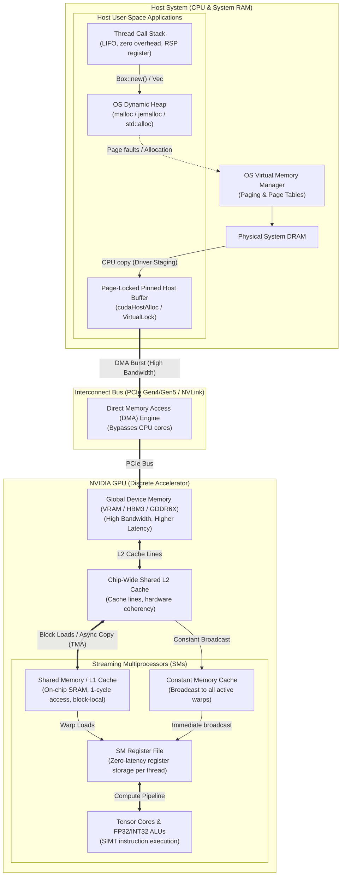
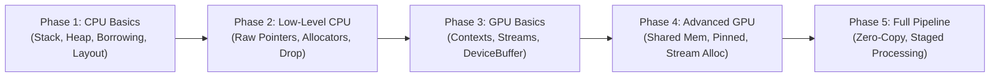
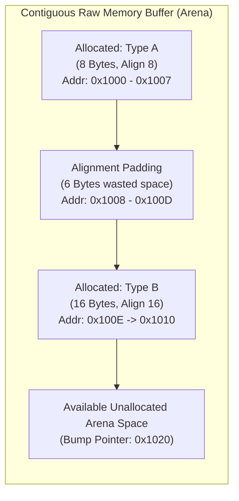
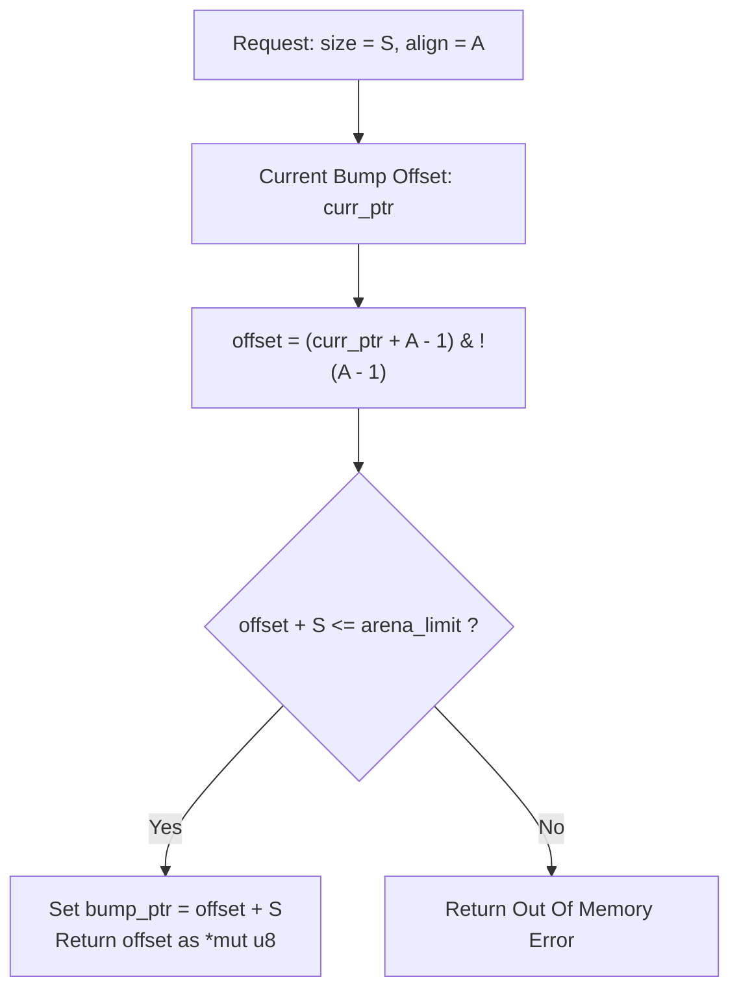
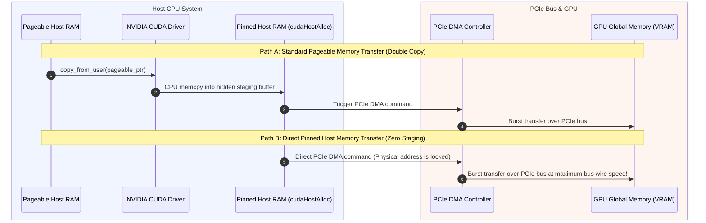
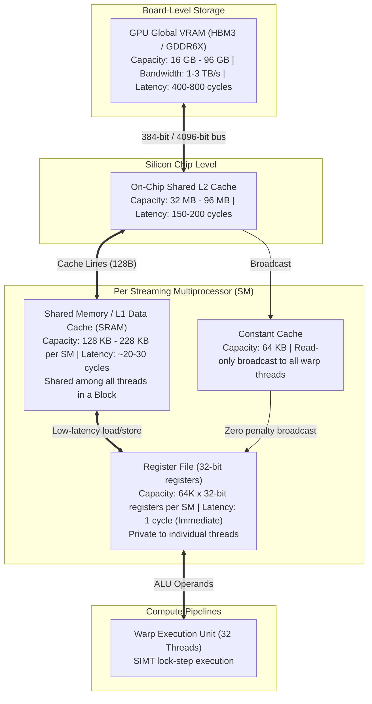
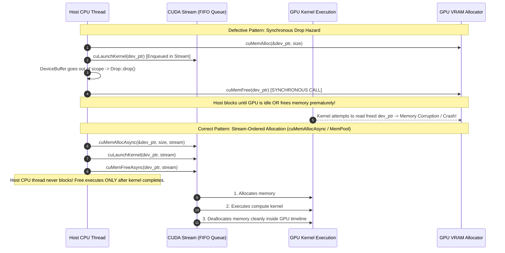
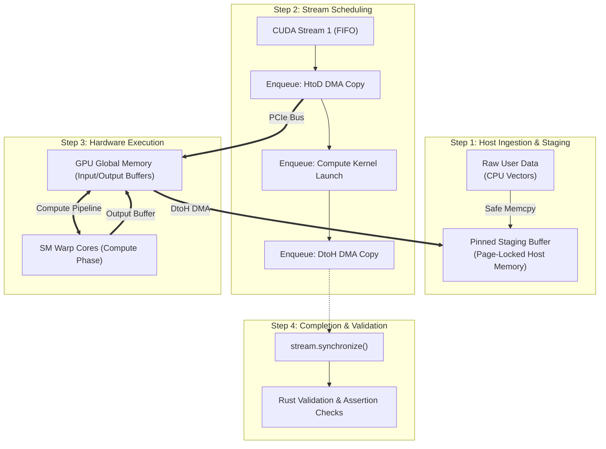

# Bare-Oxide: Rust Memory & GPU Education Platform

[](https://www.rust-lang.org)
[](LICENSE)
[](https://developer.nvidia.com/cuda-toolkit)
[](https://developer.nvidia.com/cuda-gpus)

**Bare-Oxide** is an educational systems programming repository built in Rust. It teaches hardware-conscious systems engineering, custom low-level memory allocators, pointer provenance, asynchronous runtime contracts, and GPU computing using the official **NVIDIA `cuda-rust`** architecture.

The platform guides students from fundamental CPU memory rules (stack, heap, alignment, borrowing) through low-level custom allocators, safe abstractions over unsafe memory, and into asynchronous GPU acceleration (PCIe DMA, page-locked memory, unified memory, stream-ordered allocation, and compute kernels).

All lesson modules follow **ASD-STE100** (Simplified Technical English) principles:
- Direct, active voice sentences.
- Explicit safety contracts (`// SAFETY:`).
- Architectural and memory-flow diagrams using Mermaid.
- Line-by-line code explanations, best practices, common failure modes, and hands-on exercises.

---

## Table of Contents

1. [Architectural Overview & Global Memory Flow](#1-architectural-overview--global-memory-flow)
2. [Course Roadmap & Phase Breakdown](#2-course-roadmap--phase-breakdown)
   - [Phase 1: CPU Memory Basics](#phase-1-cpu-memory-basics)
   - [Phase 2: CPU Low-Level Memory & Custom Allocators](#phase-2-cpu-low-level-memory--custom-allocators)
   - [Phase 3: GPU Memory Fundamentals with CUDA Rust](#phase-3-gpu-memory-fundamentals-with-cuda-rust)
   - [Phase 4: Advanced GPU Memory Management & Acceleration](#phase-4-advanced-gpu-memory-management--acceleration)
   - [Phase 5: Full End-to-End Processing Pipeline](#phase-5-full-end-to-end-processing-pipeline)
3. [Deep-Dive Memory Flows & Mermaid Diagrams](#3-deep-dive-memory-flows--mermaid-diagrams)
   - [Flow 1: CPU Stack, Heap, Pointer Provenance & Borrowing](#flow-1-cpu-stack-heap-pointer-provenance--borrowing)
   - [Flow 2: Low-Level Allocator Mechanics & Alignment Padding](#flow-2-low-level-allocator-mechanics--alignment-padding)
   - [Flow 3: PCIe DMA Transfer Engine (Pageable vs. Pinned Staging)](#flow-3-pcie-dma-transfer-engine-pageable-vs-pinned-staging)
   - [Flow 4: GPU Silicon Memory Hierarchy (Global to Registers)](#flow-4-gpu-silicon-memory-hierarchy-global-to-registers)
   - [Flow 5: Stream-Ordered Allocation & Asynchronous Drop Hazard](#flow-5-stream-ordered-allocation--asynchronous-drop-hazard)
   - [Flow 6: End-to-End Execution Pipeline (Phase 5 Lifecycle)](#flow-6-end-to-end-execution-pipeline-phase-5-lifecycle)
4. [Hardware and Software Requirements](#4-hardware-and-software-requirements)
5. [Repository Structure](#5-repository-structure)
6. [Getting Started & Build Guide](#6-getting-started--build-guide)
7. [Testing & Educational Methodology](#7-testing--educational-methodology)
8. [Known Limitations of Current `cuda-rust` Ecosystem](#8-known-limitations-of-current-cuda-rust-ecosystem)
9. [License](#9-license)

---

## 1. Architectural Overview & Global Memory Flow

Modern high-performance compute workloads move data through multiple tiers of hardware. Understanding the performance characteristics, synchronization boundaries, and memory ownership semantics across these tiers is essential for zero-cost systems programming.

The diagram below illustrates the end-to-end data lifecycle from host user space through the kernel allocator, PCIe DMA engine, and onto the GPU streaming multiprocessors:



---

## 2. Course Roadmap & Phase Breakdown

The course is organized into five progressive phases. Each phase contains standalone educational source crates, accompanied by ASD-STE100 instructional markdown lessons with runnable code examples, line-by-line analyses, pitfalls, and exercises.



### Phase 1: CPU Memory Basics
- **Directory**: `rust-memory-gpu-edu/phase-01-cpu-basics/`
- **Lessons**:
  - `lesson-01-stack-heap.md`: Physical stack frame mechanics, RSP register management, heap allocations, and overhead comparison.
  - `lesson-02-ownership-borrowing.md`: Rust affine type system, move semantics, unique mutable borrows (`&mut T`), and shared references (`&T`).
  - `lesson-03-lifetimes.md`: Lifetime annotations (`'a`), compiler static verification, reference scopes, and invariant checking.
  - `lesson-04-smart-pointers.md`: `Box<T>`, `Rc<T>`, `Arc<T>`, interior mutability with `RefCell<T>` and `Mutex<T>`.
  - `lesson-05-layout-and-alignment.md`: Data structure alignment, padding bytes, natural alignment rules, and `#[repr(C)]` layout guarantees.

```rust
// Example: Verifying natural alignment and layout without padding holes
#[repr(C)]
pub struct AlignedPoint {
    pub x: f32, // 4 bytes, offset 0
    pub y: f32, // 4 bytes, offset 4
    pub z: f32, // 4 bytes, offset 8
    pub w: f32, // 4 bytes, offset 12
} // Total: 16 bytes, align 4. Natural 16-byte boundary.
```

### Phase 2: CPU Low-Level Memory & Custom Allocators
- **Directory**: `rust-memory-gpu-edu/phase-02-cpu-low-level/`
- **Lessons**:
  - `lesson-01-raw-pointers-unsafe.md`: Const pointers `*const T`, mutable pointers `*mut T`, pointer arithmetic, and provenance.
  - `lesson-02-std-alloc-layout.md`: `core::alloc::Layout`, requested size vs. padding, alignment masks, and memory safety invariants.
  - `lesson-03-global-allocator.md`: Implementing the `GlobalAlloc` trait, telemetry tracking, and allocator interposition.
  - `lesson-04-custom-allocators.md`: Building custom bump allocators, arena allocators, and pool allocators from raw slices.
  - `lesson-05-manual-drop-leak-safe-wrappers.md`: `std::mem::ManuallyDrop<T>`, `std::mem::forget`, avoiding double-free defects, and safe wrappers.

```rust
// Example: Safe RAII wrapper over raw allocated memory with explicit SAFETY contracts
pub struct SafeRawBuffer<T> {
    ptr: *mut T,
    capacity: usize,
    layout: std::alloc::Layout,
}

impl<T> Drop for SafeRawBuffer<T> {
    fn drop(&mut self) {
        if !self.ptr.is_null() {
            // SAFETY: self.ptr was allocated with self.layout and has not been freed.
            unsafe {
                std::alloc::dealloc(self.ptr as *mut u8, self.layout);
            }
            self.ptr = std::ptr::null_mut();
        }
    }
}
```

### Phase 3: GPU Memory Fundamentals with CUDA Rust
- **Directory**: `rust-memory-gpu-edu/phase-03-gpu-memory-basics/`
- **Lessons**:
  - `lesson-01-cuda-context-stream.md`: Initializing GPU hardware devices, creating execution contexts, and asynchronous FIFO streams.
  - `lesson-02-devicebuffer.md`: Device memory allocation (`cuMemAlloc`), RAII memory wrappers, and element count conversions.
  - `lesson-03-host-device-copy.md`: Synchronous vs non-blocking asynchronous PCIe transfers, directionality (`HtoD` vs `DtoH`).
  - `lesson-04-devicebox-async-free.md`: Asynchronous deallocation, stream-ordered completion leases, and avoiding dangling stream operations.
  - `lesson-05-ownership-and-launch-boundary.md`: Enforcing lifetime constraints across host-to-device kernel boundaries, preventing concurrent mutations.

```rust
// Example: Safe allocation and stream synchronization
let context = EduContext::new(0)?;
let stream = context.new_stream()?;
let host_data = vec![1.0f32, 2.0f32, 3.0f32, 4.0f32];

// Synchronous safe host-to-device round-trip
let dev_buffer = EduDeviceBuffer::from_host(&stream, &host_data)?;
let downloaded = dev_buffer.to_host_vec(&stream)?;
assert_eq!(host_data, downloaded);
```

### Phase 4: Advanced GPU Memory Management & Acceleration
- **Directory**: `rust-memory-gpu-edu/phase-04-gpu-advanced/`
- **Lessons**:
  - `lesson-01-shared-memory.md`: Block-local on-chip SRAM, cooperative warp staging, memory bank conflicts, and barrier synchronization (`__syncthreads()`).
  - `lesson-02-constant-memory.md`: Constant cache hierarchies, warp-level broadcast mechanics, and read-only parameter distributions.
  - `lesson-03-disjoint-slice.md`: Safe non-overlapping GPU memory slicing, multi-kernel parallel slice mutations without aliasing.
  - `lesson-04-pinned-and-unified-memory.md`: Page-locked host allocations (`cudaHostAlloc`), DMA transfers without staging copies, and Unified Memory (`cudaMallocManaged`).
  - `lesson-05-stream-ordered-allocation.md`: High-speed memory pools (`cudaMemPool_t`), `cuMemAllocAsync`, and ordered stream lifetimes.
  - `lesson-06-kernel-models-simt-and-tile.md`: SIMT thread execution, thread block clusters, Cooperative Groups, and warp shuffle instructions.

```rust
// Example: Safe disjoint slicing prevents overlapping kernel mutations
let mut dev_buffer = EduDeviceBuffer::from_host(&stream, &[1, 2, 3, 4, 5, 6])?;
let (mut left, mut right) = dev_buffer.split_at_mut(3)?;
// Left points to [1, 2, 3] and Right points to [4, 5, 6].
// Guaranteed non-overlapping at compile-time and runtime.
```

### Phase 5: Full End-to-End Processing Pipeline
- **Directory**: `rust-memory-gpu-edu/phase-05-full-pipeline/`
- **Lessons**:
  - `lesson-01-end-to-end-example.md`: Production-grade streaming pipeline combining pinned host memory, asynchronous transfers, stream compute kernels, and validation.

---

## 3. Deep-Dive Memory Flows & Mermaid Diagrams

### Flow 1: CPU Stack, Heap, Pointer Provenance & Borrowing

The CPU stack handles lexical scopes through strict LIFO operations. The heap stores dynamically sized buffers. Rust enforces memory safety without a garbage collector through ownership rules:
1. Every value has a single owner.
2. When the owner goes out of scope, the value is dropped.
3. Multiple shared references (`&T`) OR exactly one exclusive mutable reference (`&mut T`) may exist at any time.

```mermaid
sequenceDiagram
    autonumber
    participant Caller as Caller Frame (Stack)
    participant Callee as Callee Frame (Stack)
    participant Heap as OS Heap (GlobalAlloc)
    participant Register as CPU Registers (RSP/RAX)

    Caller->>Register: Sub RSP, 0x20 (Allocate caller stack frame)
    Caller->>Heap: alloc(Layout::new::<[u8; 1024]>())
    Heap-->>Caller: Return raw pointer 0x55FA0000
    Caller->>Caller: Store Vec { ptr: 0x55FA0000, cap: 1024, len: 0 }

    Note over Caller,Callee: Function Call: Borrowing (&mut Vec)
    Caller->>Register: Sub RSP, 0x10 (Push callee stack frame)
    Caller->>Callee: Pass pointer &mut Vec (Exclusive reference)
    Callee->>Heap: Write payload into 0x55FA0000
    Callee->>Register: Add RSP, 0x10 (Pop callee stack frame)

    Note over Caller,Heap: End of Scope (RAII Drop)
    Caller->>Heap: dealloc(0x55FA0000, Layout::new::<[u8; 1024]>())
    Caller->>Register: Add RSP, 0x20 (Pop caller stack frame)
```

---

### Flow 2: Low-Level Allocator Mechanics & Alignment Padding

When implementing custom allocators (such as bump or arena allocators), memory must satisfy target CPU alignment constraints. If an address is not a multiple of the alignment, padding bytes must be inserted:





---

### Flow 3: PCIe DMA Transfer Engine (Pageable vs. Pinned Staging)

The GPU cannot perform Direct Memory Access (DMA) from standard OS pageable host memory because the operating system paging daemon might relocate or swap pages to disk during the transfer.



---

### Flow 4: GPU Silicon Memory Hierarchy (Global to Registers)

GPU hardware uses massively parallel Streaming Multiprocessors (SMs). Data must migrate into the fastest memory tiers for efficient computation:



---

### Flow 5: Stream-Ordered Allocation & Asynchronous Drop Hazard

In asynchronous GPU programming, a common defect is dropping a host-side buffer handle while asynchronous GPU work is still active on the device stream. This causes a **Synchronous Drop Hazard**.



---

### Flow 6: End-to-End Execution Pipeline (Phase 5 Lifecycle)

Phase 5 ties all concepts together in a production-style batch processing pipeline:



---

## 4. Hardware and Software Requirements

### Hardware Requirements
- **Host CPU**: x86_64 or aarch64 CPU with at least 8 GB system RAM.
- **GPU (for physical hardware execution)**:
  - NVIDIA GPU with Compute Capability 7.0 or newer (Volta, Turing, Ampere, Ada Lovelace, Hopper, Blackwell).
  - Recommended: Compute Capability 8.0+ (Ampere or newer) for full support of asynchronous stream-ordered allocations (`cuMemAllocAsync`) and hardware barrier synchronization.
- **CPU-Only / Local Testing**:
  - The repository includes an educational runtime abstraction (`common::EduContext`, `common::EduStream`, `common::EduDeviceBuffer`).
  - You can compile, check, and run tests on any system without requiring an NVIDIA GPU or CUDA drivers installed.

### Software Requirements
- **Rust Toolchain**:
  - Stable Rust 1.89+ (tested with Rust 1.94+).
  - Required cargo components: `cargo`, `rustc`.
  - For `cuda-oxide` SIMT compilation: pinned toolchain Rust `1.99.1` with `rustc-dev` and `llvm-tools` (managed via `cargo oxide`).
- **CUDA Toolkit (optional for GPU execution)**:
  - CUDA Toolkit 12.0 or newer (recommended 12.4+).
  - NVIDIA CUDA Display Driver matching or newer than the toolkit version.
- **Operating System**: Linux (Ubuntu 22.04 / 24.04 LTS, RHEL 9), macOS (CPU educational runtime mode), or Windows with WSL2.

---

## 5. Repository Structure

```
.
├── Cargo.toml                     # Top-level workspace definition
├── LICENSE                        # Apache License 2.0
├── README.md                      # Comprehensive project documentation (You are here)
└── rust-memory-gpu-edu/           # Educational workspace root
    ├── Cargo.toml                 # Cargo workspace manifest
    ├── Cargo.lock                 # Pinned dependencies
    ├── README.md                  # Workspace technical quick-start guide
    ├── common/                    # Shared educational runtime, mocks, and testing harness
    │   ├── Cargo.toml
    │   └── src/lib.rs             # Safe abstractions, DeviceBuffer, Stream, DisjointSlice
    ├── phase-01-cpu-basics/       # Phase 1: CPU Memory Basics
    │   ├── Cargo.toml
    │   ├── src/lib.rs             # Student exercises: stack, heap, borrowing, lifetimes
    │   └── lesson-01..05.md       # In-depth theory and guides
    ├── phase-02-cpu-low-level/    # Phase 2: CPU Low-Level & Custom Allocators
    │   ├── Cargo.toml
    │   ├── src/lib.rs             # Student exercises: bump allocator, safe raw buffer
    │   └── lesson-01..05.md
    ├── phase-03-gpu-memory-basics/# Phase 3: GPU Memory Fundamentals
    │   ├── Cargo.toml
    │   ├── src/lib.rs             # Student exercises: stream safety, device boxes
    │   └── lesson-01..05.md
    ├── phase-04-gpu-advanced/     # Phase 4: Advanced GPU Management
    │   ├── Cargo.toml
    │   ├── src/lib.rs             # Student exercises: disjoint slices, pinned host mem
    │   └── lesson-01..06.md
    └── phase-05-full-pipeline/    # Phase 5: Complete End-to-End Pipeline
        ├── Cargo.toml
        ├── src/main.rs            # Student exercises: full pipeline execution
        └── lesson-01-end-to-end-example.md
```

---

## 6. Getting Started & Build Guide

### Clone the Repository
```bash
git clone https://github.com/ammar-alnagar/Bare-Oxide.git
cd Bare-Oxide/rust-memory-gpu-edu
```

### Build the Workspace
```bash
# Check compilation across all crates
cargo check

# Compile all crates in debug mode
cargo build

# Compile in release mode with optimizations
cargo build --release
```

---

## 7. Testing & Educational Methodology

This platform uses an **exercise-driven pedagogical model**:
1. Every phase provides complete instructional theory in markdown format (`lesson-XX.md`).
2. The crate source files (`src/lib.rs` and `src/main.rs`) provide student exercise templates marked with `todo!()` blocks and verification tests.
3. Default verification tests pass out-of-the-box (`cargo test`), ensuring continuous integration builds cleanly.
4. Student exercises are marked with `#[ignore]` attributes. When students implement the exercises, they run:

```bash
# Test Phase 1 student implementations
cargo test -p phase-01-cpu-basics -- --ignored

# Test Phase 2 student implementations
cargo test -p phase-02-cpu-low-level -- --ignored

# Test Phase 3 student implementations
cargo test -p phase-03-gpu-memory-basics -- --ignored

# Test Phase 4 student implementations
cargo test -p phase-04-gpu-advanced -- --ignored

# Test and run Phase 5 end-to-end pipeline
cargo test -p phase-05-full-pipeline -- --ignored
cargo run -p phase-05-full-pipeline
```

---

## 8. Known Limitations of Current `cuda-rust` Ecosystem

As documented in the official [NVIDIA cuda-rust repository](https://github.com/NVIDIA/cuda-rust):
1. **Research Status**: The official `cuda-rust` platform is under active development. Low-level driver binding ABIs and kernel compiler interfaces may evolve across releases.
2. **Pinned Rust Toolchain for SIMT**: `cuda-oxide` SIMT compilation depends on private internal compiler data structures (`rustc_codegen_ssa`), requiring pinned nightly compiler versions (e.g. Rust 1.99.1).
3. **Synchronous Drop Hazard**: Dropping standard `DeviceBuffer<T>` instances triggers synchronous driver deallocation calls. For high-throughput asynchronous execution, stream-ordered memory pools (`cuMemAllocAsync`) or custom stream leases must be utilized.
4. **Compute Capability Bounds**: Advanced hardware primitives (such as Asynchronous Transaction Barriers, Tensor Memory Accelerator TMA, and Thread Block Clusters) require Compute Capability 9.0+ (Hopper architecture or newer).

---

## 9. License

This project is licensed under the **Apache License, Version 2.0**. See the [LICENSE](LICENSE) file for complete license details.
