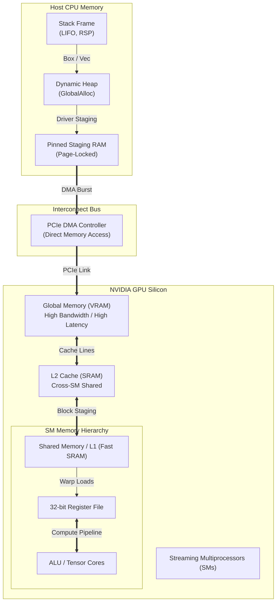

# Rust Memory & GPU Education Platform (`rust-memory-gpu-edu`)

Welcome to the comprehensive, low-level Rust systems programming course.
This project teaches CPU and GPU memory mechanics, custom allocators, safe abstractions over unsafe memory operations, and GPU computing using the official **NVIDIA `cuda-rust`** platform.

All modules follow **ASD-STE100** simplified technical English rules:
- Short, direct sentences.
- Active voice.
- Explicit safety contracts (`// SAFETY:`).
- Detailed Mermaid architectural diagrams.
- Line-by-line code breakdowns, best practices, common pitfalls, and hands-on exercises.

---

## 1. Global Architecture and Data Flow



---

## 2. Project Structure

```
rust-memory-gpu-edu/
├── README.md                      # Workspace overview, hardware/software prerequisites, build guide
├── Cargo.toml                     # Cargo workspace definition
├── common/                        # Shared abstractions, traits, and educational runtime harness
│   ├── Cargo.toml
│   └── src/lib.rs
├── phase-01-cpu-basics/           # Phase 1: CPU Memory Basics
│   ├── Cargo.toml
│   ├── src/lib.rs
│   ├── lesson-01-stack-heap.md
│   ├── lesson-02-ownership-borrowing.md
│   ├── lesson-03-lifetimes.md
│   ├── lesson-04-smart-pointers.md
│   └── lesson-05-layout-and-alignment.md
├── phase-02-cpu-low-level/        # Phase 2: CPU Low-Level Memory & Custom Allocators
│   ├── Cargo.toml
│   ├── src/lib.rs
│   ├── lesson-01-raw-pointers-unsafe.md
│   ├── lesson-02-std-alloc-layout.md
│   ├── lesson-03-global-allocator.md
│   ├── lesson-04-custom-allocators.md
│   └── lesson-05-manual-drop-leak-safe-wrappers.md
├── phase-03-gpu-memory-basics/    # Phase 3: GPU Memory with cuda-rust
│   ├── Cargo.toml
│   ├── src/lib.rs
│   ├── lesson-01-cuda-context-stream.md
│   ├── lesson-02-devicebuffer.md
│   ├── lesson-03-host-device-copy.md
│   ├── lesson-04-devicebox-async-free.md
│   └── lesson-05-ownership-and-launch-boundary.md
├── phase-04-gpu-advanced/         # Phase 4: Advanced GPU Memory Management
│   ├── Cargo.toml
│   ├── src/lib.rs
│   ├── lesson-01-shared-memory.md
│   ├── lesson-02-constant-memory.md
│   ├── lesson-03-disjoint-slice.md
│   ├── lesson-04-pinned-and-unified-memory.md
│   ├── lesson-05-stream-ordered-allocation.md
│   └── lesson-06-kernel-models-simt-and-tile.md
└── phase-05-full-pipeline/        # Phase 5: Complete End-to-End Pipeline
    ├── Cargo.toml
    ├── src/main.rs
    └── lesson-01-end-to-end-example.md
```

---

## 3. Course Progression & Syllabus


### Phase 1: CPU Memory Basics
Focuses on stack memory, heap dynamics, alignment, and the Rust borrow checker.
- Stack vs Heap allocation mechanics and RSP register behavior.
- Rust affine ownership, moves, mutable references (`&mut T`), and immutability (`&T`).
- Lifetimes (`'a`) and compile-time validation.
- Standard smart pointers: `Box<T>`, `Rc<T>`, `Arc<T>`, `RefCell<T>`.
- Data layout, padding, alignment masks, and `#[repr(C)]`.

### Phase 2: CPU Low-Level Memory & Custom Allocators
Focuses on unsafe memory manipulation, custom allocators, and pointer provenance.
- Raw pointers (`*const T`, `*mut T`) and manual pointer arithmetic.
- Allocator layouts with `core::alloc::Layout`.
- Global memory interceptors using `#[global_allocator]`.
- Custom bump allocators and arena memory pools.
- Safe wrappers over raw pointers and `std::mem::ManuallyDrop`.

### Phase 3: GPU Memory Fundamentals with CUDA Rust
Introduces GPU hardware initialization, contexts, and stream-ordered execution.
- CUDA context creation and asynchronous FIFO streams.
- `DeviceBuffer<T>` allocation and RAII cleanup.
- Synchronous and asynchronous Host-to-Device (`HtoD`) and Device-to-Host (`DtoH`) copies.
- Asynchronous deallocation, `DeviceBox`, and stream leases.
- Kernel launch safety boundaries and ownership transfers.

### Phase 4: Advanced GPU Memory Management
Covers on-chip memory tiers, pinned buffers, and memory pools.
- Dynamic and static shared memory (`__shared__`) and bank conflict avoidance.
- Constant memory cache hierarchies and warp broadcast mechanisms.
- Disjoint non-overlapping GPU slicing (`split_at_mut`) for safe concurrent kernel writes.
- Page-locked pinned host memory (`cudaHostAlloc`) and Unified Memory (`cudaMallocManaged`).
- Stream-ordered memory allocators (`cuMemAllocAsync` / `cuMemPool_t`).
- SIMT thread hierarchy, warps, and thread block clusters.

### Phase 5: Complete End-to-End Pipeline
Implements a production batch processing engine that ties CPU and GPU concepts together.
- Pinned host input staging.
- Asynchronous PCIe transfers over CUDA streams.
- Kernel compute execution and stream synchronization.
- Output validation with zero CPU stalls.

---

## 4. Hardware and Software Requirements

### Hardware Requirements
- **Host CPU**: x86_64 or aarch64 CPU with at least 8 GB RAM.
- **GPU (for live GPU execution)**:
  - NVIDIA GPU with Compute Capability 7.0 or newer (Volta, Turing, Ampere, Ada Lovelace, Hopper, Blackwell).
  - Recommended Compute Capability: 8.0+ (Ampere / Ada Lovelace / Hopper) for full support of asynchronous allocations (`cuMemAllocAsync`), thread block clusters, and asynchronous barriers.
- **CPU-Only / Local CI Testing**:
  - All lessons contain runnable code and unit tests.
  - In environments without an NVIDIA GPU or CUDA driver installed, the included workspace compiles and tests successfully using the educational runtime abstraction.

### Software Requirements
- **Rust Toolchain**:
  - Stable Rust 1.89 or newer (tested with Rust 1.94+).
  - For `cuda-oxide` SIMT compilation: pinned toolchain Rust `1.99.1` with `rustc-dev` and `llvm-tools` (managed via `cargo oxide`).
- **CUDA Toolkit**:
  - CUDA Toolkit 12.0 or newer (recommended 12.4+).
  - CUDA Driver matching or exceeding the toolkit version.
- **Git**:
  - Required to pull repository dependencies and submodules.

---

## 5. How to Build and Run Each Lesson

From the `rust-memory-gpu-edu` directory:

```bash
# Build the entire workspace
cargo build

# Check the workspace
cargo check

# Run tests (excluding student exercises in progress)
cargo test

# Run and verify your completed student exercises for each phase:
cargo test -p phase-01-cpu-basics -- --ignored
cargo test -p phase-02-cpu-low-level -- --ignored
cargo test -p phase-03-gpu-memory-basics -- --ignored
cargo test -p phase-04-gpu-advanced -- --ignored
cargo test -p phase-05-full-pipeline -- --ignored

# Run your completed end-to-end Phase 5 pipeline
cargo run -p phase-05-full-pipeline
```

---

## 6. Known Limitations of the Current `cuda-rust` Release

As documented in the official [NVIDIA cuda-rust repository](https://github.com/NVIDIA/cuda-rust):
1. **Early Research Release**: `cuda-rust` is an active research project. Kernel compiler interfaces and runtime driver bindings may undergo breaking changes across releases.
2. **Pinned Toolchains**: `cuda-oxide` SIMT model requires a pinned compiler version (Rust 1.99.1) because it relies on private `rustc_codegen_ssa` internal compiler APIs.
3. **Synchronous Drop vs Asynchronous Free**: `DeviceBuffer<T>` drop executes synchronous `cuMemFree` unless stream-ordered completion leases or asynchronous drop wrappers are used. Dropping buffers while asynchronous stream work is in-flight without synchronization will result in driver error or undefined behavior.
4. **Hardware-Specific Features**: Advanced capabilities such as Thread Block Clusters require Compute Capability 9.0+ (Hopper). Dynamic shared memory opt-in sizes exceeding 48 KiB require explicit device attribute queries.
