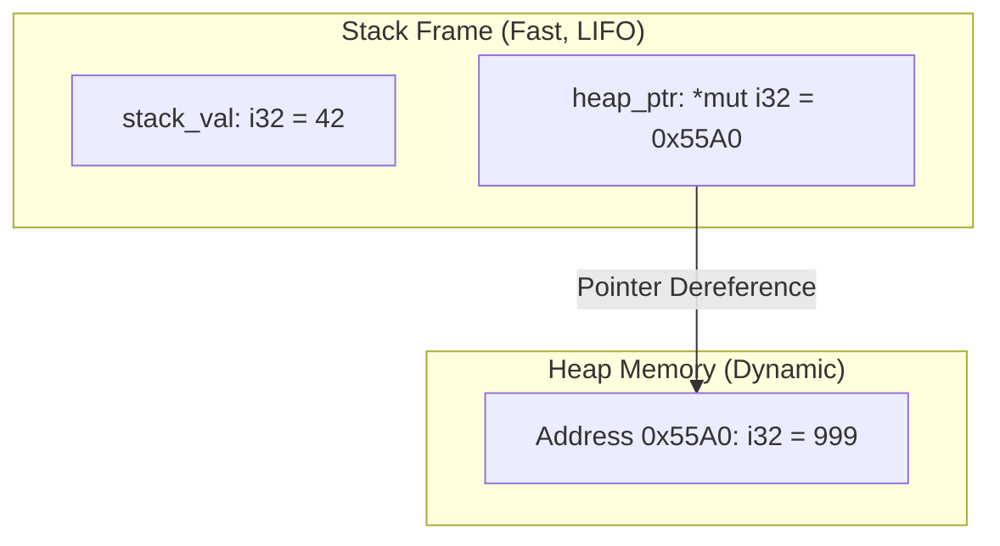

# Lesson 1: Stack vs Heap Memory

## Learning Goals
- Understand the physical difference between CPU stack memory and heap memory.
- Learn stack frame push and pop mechanics.
- Understand heap allocation overhead and dynamic sizing.
- Analyze pointer dereferencing from stack to heap.

---

## 1. Theory: Stack and Heap Architecture

The CPU uses two primary memory zones: the **Stack** and the **Heap**.

### The Stack
The stack stores local variables with known, fixed sizes at compile time.
- Operates in Last-In, First-Out (LIFO) order.
- Pushing a stack frame increments or decrements the stack pointer register (`RSP`).
- Stack allocation has zero runtime metadata overhead. It requires only one CPU subtraction instruction.
- Deallocation occurs automatically when a function call returns.

### The Heap
The heap stores data whose size is dynamic or unknown at compile time.
- The operating system and dynamic memory allocator (e.g., `ptmalloc`, `jemalloc`) manage the heap.
- Allocating memory requires finding an address range that satisfies size and alignment rules.
- Accessing heap memory requires dereferencing a stack-allocated pointer. This adds memory latency.
- Deallocation requires releasing the address range back to the allocator.

---

## 2. Memory Layout Diagram



---

## 3. Complete Rust Code Example

```rust
fn main() {
    // 1. Stack allocation: Fixed size known at compile time
    let stack_int: i32 = 42;
    let stack_array: [u8; 4] = [1, 2, 3, 4];

    // 2. Heap allocation: Pointer resides on stack, payload resides on heap
    let heap_box: Box<i32> = Box::new(999);
    let mut heap_vector: Vec<u8> = Vec::with_capacity(4);
    heap_vector.extend_from_slice(&stack_array);

    println!("stack_int value: {}", stack_int);
    println!("heap_box payload: {}", *heap_box);
    println!("heap_vector len: {}, capacity: {}", heap_vector.len(), heap_vector.capacity());
}
```

---

## 4. Code Breakdown

1. `let stack_int: i32 = 42;`:
   - Allocates 4 bytes directly inside the stack frame of `main`.
2. `let stack_array: [u8; 4] = [1, 2, 3, 4];`:
   - Allocates 4 bytes contiguously on the stack. No heap allocator call occurs.
3. `let heap_box: Box<i32> = Box::new(999);`:
   - Calls the global allocator to request 4 bytes on the heap.
   - Stores the 64-bit memory address on the stack inside `heap_box`.
4. `let mut heap_vector: Vec<u8> = Vec::with_capacity(4);`:
   - A `Vec` consists of three 64-bit words on the stack: a pointer (`*mut T`), capacity (`usize`), and length (`usize`).
   - The buffer payload of 4 bytes is allocated on the heap.
5. End of scope:
   - When `main` finishes, the stack frame unwinds.
   - `heap_vector` and `heap_box` run their `Drop` implementations, returning heap memory to the allocator.

---

## 5. Best Practices

1. **Prefer stack allocation**: Use stack-allocated types when the size is small and fixed.
2. **Avoid excessive heap allocation in hot loops**: Repeated heap allocations trigger system calls and allocator lock contention.
3. **Pre-allocate vector capacity**: Use `Vec::with_capacity` to prevent repeated reallocations and copies.
4. **Keep stack frames bounded**: Large arrays on the stack can cause stack overflow crashes.

---

## 6. Common Errors

- **Stack Overflow**: Allocating an array that exceeds the stack quota (typically 2MB to 8MB).
  - *Fix*: Wrap large arrays in `Box` to place them on the heap.
- **Hidden Allocations**: Calling methods like `.clone()` on dynamic collections inside critical loops.
  - *Fix*: Pass borrowed references (`&T`) instead of cloning.

---

## 7. Exercises

1. Write a function that checks the memory address of two consecutive local `i32` variables. Verify whether your CPU architecture grows the stack downward or upward.
2. Create a `Vec<u64>`. Inspect its length, capacity, and pointer address before and after adding 1,000 elements without `with_capacity`.

---

## 8. Summary & Checklist

- [x] Stack memory has zero metadata overhead and operates in LIFO order.
- [x] Heap memory supports dynamic sizing but requires allocator tracking.
- [x] Smart pointers hold heap addresses on the stack.
- [x] RAII cleans up heap memory automatically when pointers leave scope.
