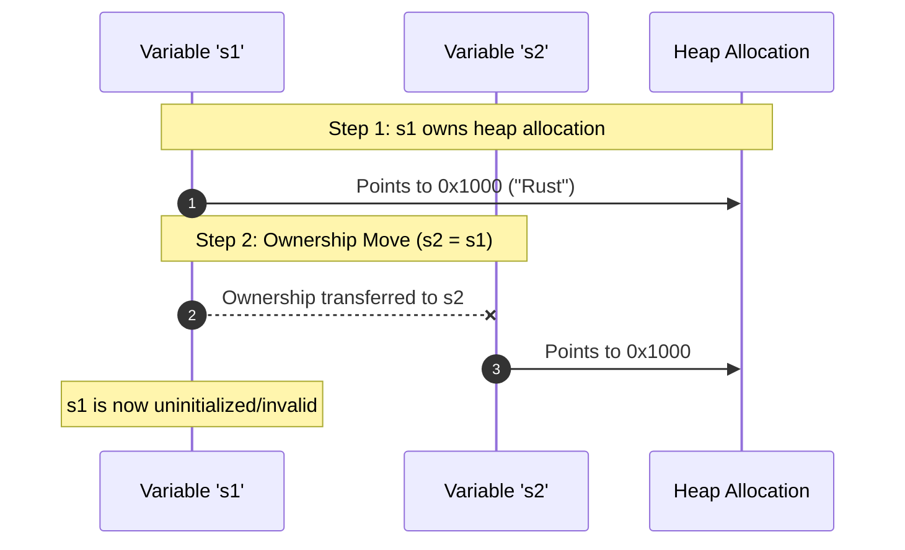

# Lesson 2: Ownership, Moves, and Borrowing

## Learning Goals
- Master the Rust ownership rules and move semantics.
- Understand how Rust enforces compile-time safety without a garbage collector.
- Learn immutable borrowing (`&T`) versus mutable borrowing (`&mut T`).
- Apply the core safety principle: Aliasing XOR Mutability.

---

## 1. Theory: Ownership and Borrowing Mechanics

Rust governs CPU memory through three fundamental rules:
1. Each value in Rust has an owner variable.
2. There can only be one owner at a time.
3. When the owner goes out of scope, Rust automatically drops the value.

### Move Semantics
When you assign or pass an owning type (like `Vec` or `String`) to another variable or function, Rust moves ownership. The source variable becomes invalid. The compiler forbids further reads from the moved variable at zero runtime cost.

### Borrowing Rules
Instead of transferring ownership, code can create references:
- **Shared Reference (`&T`)**: Multiple parts of the program may read simultaneously. Mutation is forbidden.
- **Exclusive Reference (`&mut T`)**: Exactly one reference may access and mutate the value. No other references (read or write) may exist simultaneously.

This rule is **Aliasing XOR Mutability**. It completely prevents data races at compile time.

---

## 2. Memory Flow Diagram



---

## 3. Complete Rust Code Example

```rust
fn print_length(s: &String) {
    // Shared borrow: read-only access
    println!("Borrowed length: {}", s.len());
}

fn append_suffix(s: &mut String) {
    // Exclusive borrow: safe mutation
    s.push_str(" Rules");
}

fn main() {
    // 1. Initial ownership
    let s1 = String::from("Memory");

    // 2. Move semantics
    let mut s2 = s1; // s1 moved to s2; s1 cannot be used

    // 3. Shared borrow
    print_length(&s2);

    // 4. Mutable borrow
    append_suffix(&mut s2);
    println!("Updated string: {}", s2);

    // 5. Destructor runs here
}
```

---

## 4. Code Breakdown

1. `let s1 = String::from("Memory");`:
   - Allocates buffer on heap with capacity and length. Stack owns `s1`.
2. `let mut s2 = s1;`:
   - Moves the 24-byte stack descriptor from `s1` to `s2`.
   - The heap address remains unchanged.
   - `s1` is statically invalidated by the compiler.
3. `print_length(&s2);`:
   - Passes an immutable reference (`&s2`).
   - The function cannot modify `s2`. Multiple immutable references can exist concurrently.
4. `append_suffix(&mut s2);`:
   - Passes a unique mutable reference (`&mut s2`).
   - The compiler ensures no other aliases exist during this call.
5. End of `main`:
   - `s2` is dropped. The heap buffer deallocates. `s1` has no drop action because it was moved.

---

## 5. Best Practices

1. **Borrow by default**: Pass `&T` when you only need to read data.
2. **Limit mutable borrow scope**: Keep mutable borrow lifetimes as narrow as possible.
3. **Avoid unnecessary cloning**: Do not call `.clone()` simply to satisfy the borrow checker. Structure your data flow instead.
4. **Use ownership transfer for resource sinks**: When a function consumes or transforms a resource, take ownership by value.

---

## 6. Common Errors

- **Use after move**: Trying to access `s1` after moving it to `s2`.
  - *Fix*: Pass a borrow (`&s1`) if `s1` must remain accessible.
- **Simultaneous mutable and immutable borrow**: Holding `&s` while calling a method that requires `&mut s`.
  - *Fix*: Complete all reads before initiating a mutable borrow.

---

## 7. Exercises

1. Write a function that takes a `Vec<i32>` by value, multiplies every element by 2, and returns the modified vector to the caller.
2. Create code that causes a compile error by attempting to mutate a vector while iterating over it with a shared reference. Then refactor the code to compile cleanly.

---

## 8. Summary & Checklist

- [x] Ownership guarantees exactly one owner for every heap resource.
- [x] Moves transfer ownership at zero runtime cost without deep copies.
- [x] Shared references (`&T`) allow concurrent reads without mutation.
- [x] Mutable references (`&mut T`) guarantee exclusive access.
- [x] Aliasing XOR Mutability prevents memory corruption and race conditions.
