# Lesson 3: Lifetime Rules and Borrow Checker Mechanics

## Learning Goals
- Understand how the Rust compiler tracks reference lifetimes.
- Learn lifetime syntax annotations (`'a`, `'static`).
- Master lifetime elision rules.
- Prevent dangling references at compile time.

---

## 1. Theory: Lifetimes and Pointer Validity

A reference in Rust cannot outlive the data it refers to. The borrow checker enforces this invariant through **Lifetimes**.

A lifetime is the static scope within which a reference is valid.
- Lifetimes are entirely compile-time metadata. They have zero runtime representation or cost.
- Lifetimes are denoted with a leading apostrophe (e.g., `'a`).
- When a function accepts references and returns a reference, annotations tell the compiler which input reference parameter determines the lifetime of the output reference.

### Lifetime Invariant
For any reference `&'a T`, the referee `T` must live for at least as long as `'a`. If `T` drops while `'a` is still active, the borrow checker rejects the code.

---

## 2. Lifetime Timeline Diagram

```mermaid
gantt
    title Reference Lifetime vs Data Lifetime
    dateFormat X
    axisFormat %s
    section Target Data
    Owned String 's'        :active, data1, 0, 10
    section Valid Borrow
    Reference 'r1' (&s)     :crit, ref1, 2, 7
    section Invalid Borrow (Prevented)
    Dangling Ref Attempt    :ref2, 8, 12
```



---

## 3. Complete Rust Code Example

```rust
// The returned reference will live as long as the shorter of x and y
fn longest<'a>(x: &'a str, y: &'a str) -> &'a str {
    if x.len() > y.len() {
        x
    } else {
        y
    }
}

struct TokenHolder<'a> {
    token: &'a str,
}

fn main() {
    let string1 = String::from("long string is long");
    let result;
    {
        let string2 = String::from("xyz");
        result = longest(string1.as_str(), string2.as_str());
        println!("The longest string within inner scope: {}", result);
    }
    // Note: 'result' cannot be used here because 'string2' dropped at the end of the block

    let holder = TokenHolder { token: "static_token_slice" };
    println!("Holder token: {}", holder.token);
}
```

---

## 4. Code Breakdown

1. `fn longest<'a>(x: &'a str, y: &'a str) -> &'a str`:
   - Declares generic lifetime parameter `'a`.
   - Tells the compiler that the returned string slice will live as long as the intersection of `'a` from both arguments.
2. `let string1 = String::from(...);`:
   - Allocates the first string in outer scope.
3. Inner block `{ let string2 = ... }`:
   - `string2` lives only until the closing brace.
   - `longest` executes safely. The output `result` is bounded by `string2`'s lifetime.
4. `struct TokenHolder<'a>`:
   - Structs that hold references must declare explicit lifetime parameters to ensure the struct does not outlive its referenced data.

---

## 5. Best Practices

1. **Rely on lifetime elision**: Do not annotate function signatures when the compiler elides lifetimes automatically (e.g., single input reference functions).
2. **Favor ownership in structs when possible**: Use owned types (`String`, `Vec`) in structs unless borrowing is specifically required for performance or zero-copy parsing.
3. **Keep borrow scopes small**: Reduce the span of references to avoid holding borrows across function calls.
4. **Use `'static` only for true global constants**: Avoid forcing `'static` lifetimes onto heap data unless using `Box::leak` intentionally.

---

## 6. Common Errors

- **Returning reference to local variable**:
  ```rust
  // FAILS TO COMPILE:
  // fn get_str() -> &str {
  //     let s = String::from("hello");
  //     &s // s drops when function exits!
  // }
  ```
  - *Fix*: Return an owned `String` instead of a borrowed reference.

---

## 7. Exercises

1. Define a struct `ParsedView<'a>` that holds a reference to a slice of integers `&'a [i32]`. Implement a method `first_element(&self) -> Option<&'a i32>`.
2. Write a function that accepts two string slices and returns the prefix common to both slices. Correctly annotate the lifetime signatures.

---

## 8. Summary & Checklist

- [x] Lifetimes prevent dangling pointers at compile time.
- [x] Lifetimes incur zero runtime overhead.
- [x] Functions returning references require annotations when input sources are ambiguous.
- [x] Structs holding references must specify lifetime parameters.
