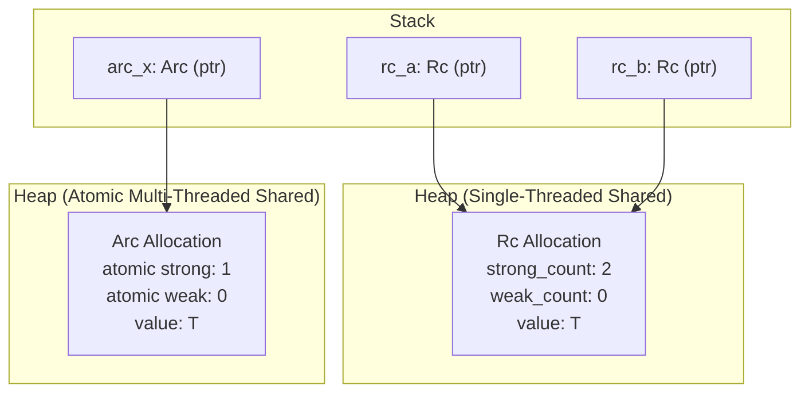

# Lesson 4: Standard Smart Pointers (`Box`, `Vec`, `String`, `Rc`, `Arc`)

## Learning Goals
- Understand the internal memory layout of standard Rust smart pointers.
- Learn single ownership (`Box`, `Vec`, `String`) versus shared ownership (`Rc`, `Arc`).
- Examine atomic reference counting (`Arc`) vs non-atomic reference counting (`Rc`).
- Understand dereference coercion (`Deref` trait) and automatic cleanup (`Drop` trait).

---

## 1. Theory: Smart Pointer Architecture

Smart pointers are data structures that act like pointers while offering additional capabilities such as automatic memory management and metadata tracking.

### Single Ownership Pointers
- **`Box<T>`**: Unique ownership of a heap allocation. The pointer on the stack is 8 bytes (one word). When `Box` drops, it deallocates the heap block.
- **`Vec<T>`**: Contiguous growable array. Stack descriptor has 3 words (24 bytes): `ptr`, `cap`, `len`.
- **`String`**: UTF-8 validated wrapper around `Vec<u8>`.

### Shared Ownership Pointers
- **`Rc<T>`**: Reference Counted pointer for single-threaded shared ownership.
  - The heap allocation holds the inner data `T`, strong count (`usize`), and weak count (`usize`).
  - Cloning `Rc` increments the strong count without copying `T`.
  - Not thread-safe (`!Send`, `!Sync`).
- **`Arc<T>`**: Atomically Reference Counted pointer for multi-threaded shared ownership.
  - Modifies reference counts using CPU atomic fetch-and-add instructions (`atomic::fetch_add`).
  - Thread-safe (`Send + Sync` when `T: Send + Sync`). Has higher runtime cost than `Rc`.

---

## 2. Memory Structure Diagram



---

## 3. Complete Rust Code Example

```rust
use std::rc::Rc;
use std::sync::Arc;
use std::thread;

fn main() {
    // 1. Box: Single heap allocation
    let boxed_val = Box::new(1024);
    println!("Boxed value: {}", *boxed_val);

    // 2. Rc: Shared ownership in a single thread
    let rc_data = Rc::new(vec![10, 20, 30]);
    let rc_clone = Rc::clone(&rc_data);
    println!("Rc strong count: {}", Rc::strong_count(&rc_data));

    // 3. Arc: Shared ownership across threads
    let arc_data = Arc::new(vec![100, 200, 300]);
    let arc_clone = Arc::clone(&arc_data);

    let handle = thread::spawn(move || {
        println!("Arc data inside thread: {:?}", *arc_clone);
    });

    handle.join().unwrap();
    println!("Arc strong count after thread joins: {}", Arc::strong_count(&arc_data));
}
```

---

## 4. Code Breakdown

1. `Box::new(1024)`:
   - Requests 4 bytes from the heap allocator. Stores pointer on the stack.
2. `Rc::new(...)`:
   - Allocates memory for metadata (two counter fields) plus the inner `Vec`.
   - `Rc::clone(&rc_data)` does not duplicate vector elements. It increments the counter from 1 to 2.
3. `Arc::new(...)`:
   - Allocates inner payload plus two `AtomicUsize` counters on the heap.
4. `thread::spawn(move || ...)`:
   - Moves `arc_clone` into the new OS thread.
   - `Arc` allows shared cross-thread read access safely.
5. Scope exit:
   - When each pointer drops, it decrements its respective count. The final pointer deallocates the heap block.

---

## 5. Best Practices

1. **Use `Box<T>` for recursive types and large data**: `Box` provides clean heap indirection with zero reference-counting overhead.
2. **Prefer `Rc` over `Arc` in single-threaded code**: `Rc` avoids costly CPU atomic memory bus synchronization.
3. **Use `Arc::clone(&handle)` instead of `.clone()` directly**: This makes it clear that you are cloning the pointer handle, not performing a deep copy of the underlying data.
4. **Beware of reference cycles**: Use `Weak<T>` with `Rc` or `Arc` when constructing cyclic graphs or parent-child trees to avoid memory leaks.

---

## 6. Common Errors

- **Attempting to send `Rc` across threads**:
  - Compiler error: `Rc<T> cannot be sent between threads safely`.
  - *Fix*: Replace `Rc` with `Arc`.
- **Memory leaks from reference cycles**: Two `Rc` instances pointing to each other will never reach a count of zero.
  - *Fix*: Break cycles with `Rc::downgrade` into `Weak` references.

---

## 7. Exercises

1. Create a binary tree node struct where child nodes are owned using `Option<Box<TreeNode>>`.
2. Implement a simple job queue where worker threads share read access to configuration data using `Arc`.

---

## 8. Summary & Checklist

- [x] `Box<T>` is a unique owning pointer with zero reference count overhead.
- [x] `Vec<T>` and `String` are dynamic collections that manage continuous heap buffers.
- [x] `Rc<T>` enables single-threaded shared ownership via non-atomic counters.
- [x] `Arc<T>` enables multi-threaded shared ownership via atomic instructions.
- [x] Reference counts drop to zero before freeing heap resources.
