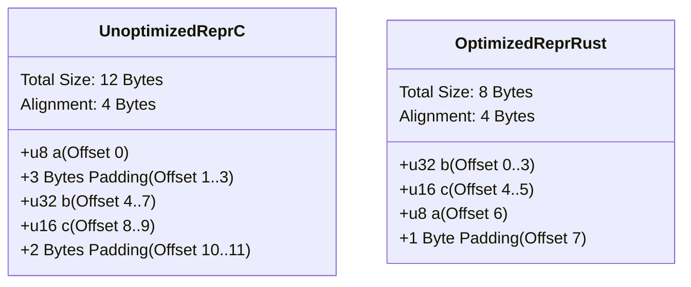

# Lesson 5: Layout, Alignment, and Padding

## Learning Goals
- Understand CPU memory alignment and hardware access efficiency.
- Master `std::mem::size_of`, `align_of`, and `offset_of!`.
- Understand how padding bytes prevent unaligned memory access.
- Learn compiler field reordering (`repr(Rust)` vs `repr(C)`).

---

## 1. Theory: CPU Alignment and Data Layout

Modern CPUs read and write memory in bus-sized words (e.g., 32-bit, 64-bit, or 128-bit chunks).
- An address is **aligned** to $N$ bytes if:
  $$\text{Address} \pmod N = 0$$
- Primitive data types require specific natural alignments:
  - `u8`, `i8`: 1 byte alignment.
  - `u16`, `i16`: 2 byte alignment.
  - `u32`, `f32`: 4 byte alignment.
  - `u64`, `f64`, pointers: 8 byte alignment.
- Reading an unaligned word on some architectures (e.g., older ARM, SPARC) causes a hardware bus fault. On x86_64, unaligned access incurs a latency penalty or requires two memory transactions.

### Padding and Struct Alignment
The compiler inserts unused **padding bytes** between struct fields to ensure every field satisfies its alignment requirement.
The total size of a struct is always rounded up to a multiple of its largest field alignment.

---

## 2. Memory Layout Diagram



---

## 3. Complete Rust Code Example

```rust
use std::mem::{align_of, size_of};

#[repr(C)]
struct UnpackedC {
    a: u8,   // 1 byte
    // 3 bytes padding inserted here
    b: u32,  // 4 bytes
    c: u16,  // 2 bytes
    // 2 bytes trailing padding inserted here
}

#[repr(Rust)]
struct PackedRust {
    a: u8,
    b: u32,
    c: u16,
}

fn main() {
    println!("UnpackedC size: {} bytes, align: {} bytes",
        size_of::<UnpackedC>(), align_of::<UnpackedC>());

    println!("PackedRust size: {} bytes, align: {} bytes",
        size_of::<PackedRust>(), align_of::<PackedRust>());

    assert_eq!(size_of::<UnpackedC>(), 12);
    assert_eq!(size_of::<PackedRust>(), 8);
}
```

---

## 4. Code Breakdown

1. `#[repr(C)] struct UnpackedC`:
   - `repr(C)` guarantees the exact field ordering defined in source code.
   - Field `a` starts at byte 0.
   - Field `b` requires 4-byte alignment, so the compiler inserts 3 padding bytes (bytes 1, 2, 3).
   - Field `c` starts at byte 8 (aligned to 2).
   - The total struct size must be divisible by 4, so 2 trailing padding bytes are added (total = 12 bytes).
2. `#[repr(Rust)] struct PackedRust`:
   - `repr(Rust)` is the default representation. The compiler can reorder fields to minimize padding.
   - The compiler rearranges the layout to: `b` (4 bytes), `c` (2 bytes), `a` (1 byte), 1 trailing byte padding.
   - Total size drops from 12 bytes to 8 bytes (a 33% memory reduction).

---

## 5. Best Practices

1. **Order struct fields from largest to smallest alignment** when using `#[repr(C)]`: This eliminates internal padding.
2. **Use `#[repr(C)]` for FFI and GPU transfers**: The default `repr(Rust)` layout is not guaranteed across compiler versions or compiler backends.
3. **Use `std::mem::size_of` and `std::mem::align_of`**: Never hardcode byte sizes when interfacing with system APIs.
4. **Use `bytemuck` traits for zero-copy casts**: Ensure types implement `Pod` or `NoUninit` to guarantee all bit patterns are valid.

---

## 6. Common Errors

- **Sending `#[repr(Rust)]` types to GPU or C code**:
  - The GPU driver expects consistent C-compatible memory layouts.
  - *Fix*: Always annotate host-device shared types with `#[repr(C)]`.
- **Transmuting uninitialized padding bytes**:
  - Reading uninitialized padding bytes is undefined behavior.
  - *Fix*: Initialize memory using `bytemuck::Zeroable` or explicit field initialization.

---

## 7. Exercises

1. Define a struct containing a `u8`, a `u64`, a `u16`, and an `f32`. Calculate its size under `#[repr(C)]`. Then rearrange fields to achieve minimum size.
2. Verify your calculations using `size_of` and `align_of` in a Rust test.

---

## 8. Summary & Checklist

- [x] CPUs access memory efficiently when addresses match natural data alignment.
- [x] Padding bytes align struct fields at the cost of memory overhead.
- [x] `repr(Rust)` reorders fields automatically to minimize padding.
- [x] `repr(C)` preserves field ordering for hardware and FFI interfaces.
- [x] GPU data structures must use deterministic C layouts.
