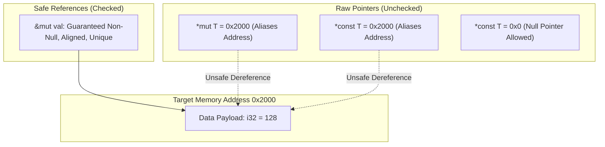

# Lesson 1: Raw Pointers and Unsafe Rust

## Learning Goals
- Understand raw pointers (`*const T`, `*mut T`) and how they differ from safe references (`&T`, `&mut T`).
- Learn the rules of pointer provenance and address arithmetic.
- Identify the five operations that require an `unsafe` block in Rust.
- Document and enforce memory safety contracts using `// SAFETY:` comments.

---

## 1. Theory: Raw Pointers vs References

In safe Rust, references (`&T`, `&mut T`) carry strong invariants guaranteed by the compiler:
1. They are never null.
2. They are properly aligned.
3. They point to valid, initialized memory.
4. They strictly obey the aliasing rules (Aliasing XOR Mutability).

In contrast, **raw pointers** (`*const T`, `*mut T`) bypass compiler checks:
- Raw pointers can be null.
- Raw pointers can be misaligned.
- Raw pointers can point to uninitialized, deallocated, or arbitrary memory addresses.
- Raw pointers can alias freely; multiple mutable raw pointers can point to the same byte.

### The Five Unsafe Superpowers
Creating a raw pointer is safe. **Dereferencing** a raw pointer is `unsafe`.
The five core actions requiring `unsafe` are:
1. Dereference raw pointers.
2. Call unsafe functions or methods.
3. Implement unsafe traits.
4. Mutate mutable static variables.
5. Access fields of a `union`.

Every `unsafe` block must have a preceding `// SAFETY:` comment stating why the action is sound.

---

## 2. Memory State Diagram



---

## 3. Complete Rust Code Example

```rust
fn main() {
    let mut value: i32 = 128;

    // 1. Safe creation of raw pointers from references
    let raw_const: *const i32 = &value;
    let raw_mut: *mut i32 = &mut value;

    // 2. Unsafe dereference of raw pointer
    // SAFETY: raw_const is derived from a live local variable 'value',
    // which remains in scope, is aligned to 4 bytes, and is non-null.
    unsafe {
        println!("Value via raw_const: {}", *raw_const);
    }

    // 3. Pointer arithmetic and mutation
    // SAFETY: raw_mut points to valid, initialized memory for 'value'.
    // No other safe references exist at this instant.
    unsafe {
        *raw_mut = 256;
        println!("Updated value via raw_mut: {}", *raw_mut);
    }

    // 4. Array traversal using raw pointer arithmetic
    let numbers: [u32; 3] = [10, 20, 30];
    let base_ptr: *const u32 = numbers.as_ptr();

    for offset in 0..3 {
        // SAFETY: offset is strictly within the bounds of numbers array (len = 3).
        // Pointer arithmetic does not overflow or wrap.
        unsafe {
            let elem_ptr = base_ptr.add(offset);
            println!("Element at index {}: {}", offset, *elem_ptr);
        }
    }
}
```

---

## 4. Code Breakdown

1. `let raw_const: *const i32 = &value;`:
   - Coerces safe reference `&value` to a constant raw pointer.
   - Rust allows creating raw pointers in safe code.
2. `unsafe { println!("{}", *raw_const); }`:
   - The asterisk `*` dereferences the pointer.
   - The programmer must verify that the pointer is non-null, aligned, and points to initialized memory.
3. `*raw_mut = 256;`:
   - Writes directly to the target memory address.
4. `base_ptr.add(offset)`:
   - Performs pointer arithmetic based on `std::mem::size_of::<u32>()` (advances 4 bytes per unit).
   - Calling `.add()` past the allocated buffer bounds is undefined behavior.

---

## 5. Best Practices

1. **Keep `unsafe` blocks minimal**: Isolate unsafe operations into the smallest possible block.
2. **Always document the `// SAFETY:` rationale**: Explain clearly why the pointer is valid, aligned, non-null, and un-aliased.
3. **Use `NonNull<T>` when pointers cannot be null**: `NonNull<T>` is covariant and optimizes memory layout with null-pointer niche optimization.
4. **Prefer `.add()` and `.sub()` over manual integer casting**: Pointer methods preserve compiler provenance information.

---

## 6. Common Errors

- **Null Pointer Dereference**:
  - Dereferencing `std::ptr::null()` triggers immediate undefined behavior (segfault or silent memory corruption).
  - *Fix*: Check `!ptr.is_null()` before dereferencing, or use `Option<NonNull<T>>`.
- **Misaligned Pointer Access**:
  - Dereferencing a pointer not divisible by `align_of::<T>()`.
  - *Fix*: Use `std::ptr::read_unaligned` if memory cannot be aligned.

---

## 7. Exercises

1. Write a function `swap_raw(a: *mut i32, b: *mut i32)` that swaps two values using raw pointers. Include a comprehensive `// SAFETY:` comment.
2. Write a function that uses raw pointer arithmetic to reverse an array of bytes in place.

---

## 8. Summary & Checklist

- [x] Raw pointers bypass compiler borrow and alignment guarantees.
- [x] Dereferencing raw pointers requires an `unsafe` block.
- [x] Every unsafe block must contain an explicit `// SAFETY:` justification.
- [x] Pointer provenance must be preserved to prevent undefined behavior.
