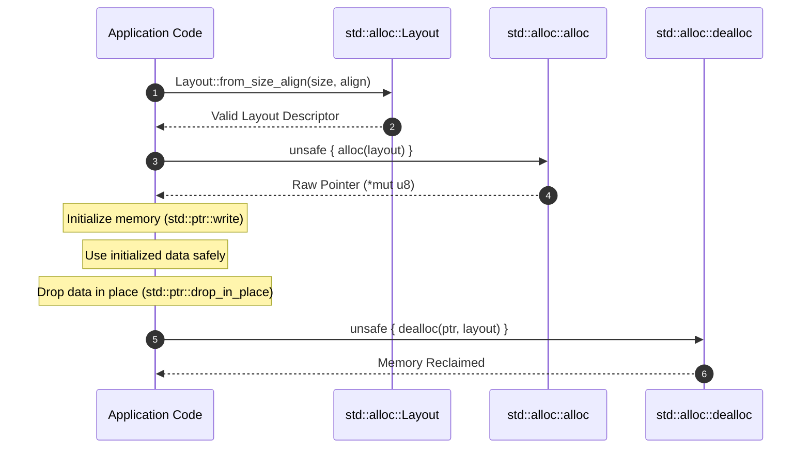

# Lesson 2: Direct Allocation with `std::alloc::{alloc, dealloc, Layout}`

## Learning Goals
- Understand the low-level allocator API in `std::alloc`.
- Master `std::alloc::Layout` construction, size, and alignment requirements.
- Manage manual memory lifecycles without leaking or double-freeing.
- Implement explicit initialization and clean deallocation.

---

## 1. Theory: The Core Allocator Contract

When higher-level containers like `Box` or `Vec` request memory, they delegate to the standard library's `std::alloc` module.

The primary functions are:
- `alloc(layout: Layout) -> *mut u8`: Allocates raw, uninitialized bytes matching the requested `Layout`. Returns a null pointer on out-of-memory.
- `dealloc(ptr: *mut u8, layout: Layout)`: Frees the memory block previously allocated with `alloc`.
- `realloc(ptr: *mut u8, layout: Layout, new_size: usize) -> *mut u8`: Grows or shrinks an existing allocation.

### The Safety Contract of `dealloc`
The programmer must uphold strict invariants when calling `dealloc`:
1. `ptr` must have been returned by the same allocator.
2. `layout` must **identically match** the `Layout` used when allocating the block (same size and same alignment).
3. `ptr` must not be used after `dealloc` runs (prevent Use-After-Free).
4. `dealloc` must be called exactly once per allocation (prevent Double-Free).

---

## 2. Memory Lifecycle Sequence



---

## 3. Complete Rust Code Example

```rust
use std::alloc::{alloc, dealloc, Layout};
use std::ptr;

fn main() {
    // 1. Define layout for 4 x u32 values (16 bytes, 4-byte alignment)
    let count = 4;
    let layout = Layout::array::<u32>(count).expect("Valid array layout");

    // 2. Allocate uninitialized memory block
    // SAFETY: Layout has nonzero size (16 bytes) and valid power-of-two alignment (4).
    let raw_ptr: *mut u32 = unsafe {
        let p = alloc(layout) as *mut u32;
        if p.is_null() {
            std::alloc::handle_alloc_error(layout);
        }
        p
    };

    // 3. Initialize elements using ptr::write
    for i in 0..count {
        // SAFETY: i is within 0..4; raw_ptr is valid and properly aligned.
        unsafe {
            ptr::write(raw_ptr.add(i), (i as u32 + 1) * 10);
        }
    }

    // 4. Read initialized data
    for i in 0..count {
        // SAFETY: Memory at raw_ptr.add(i) has been initialized above.
        unsafe {
            println!("Element {}: {}", i, *raw_ptr.add(i));
        }
    }

    // 5. Deallocate memory
    // SAFETY: raw_ptr was allocated with 'layout', all elements are done,
    // and raw_ptr will never be accessed again.
    unsafe {
        dealloc(raw_ptr as *mut u8, layout);
    }
}
```

---

## 4. Code Breakdown

1. `Layout::array::<u32>(count)`:
   - Computes total byte size (`4 * 4 = 16 bytes`) and ensures size does not overflow `usize`.
   - Derives alignment requirement (`align_of::<u32>() = 4`).
2. `alloc(layout)`:
   - Invokes the allocator. Returns `*mut u8`.
   - If the system is out of memory, it returns null. The code checks `p.is_null()` and calls `handle_alloc_error`.
3. `ptr::write(raw_ptr.add(i), ...)`:
   - Writes values directly to raw memory without reading or dropping uninitialized bytes.
   - Do NOT use `*ptr = val` on uninitialized memory if `T` implements `Drop`, because assignment drops the old value first!
4. `dealloc(raw_ptr as *mut u8, layout)`:
   - Releases the memory back to the operating system or heap manager.

---

## 5. Best Practices

1. **Always use `Layout::array::<T>` or `Layout::new::<T>`**: Avoid computing byte counts by hand to prevent integer overflow vulnerabilities.
2. **Always initialize memory with `std::ptr::write`**: Direct assignment `*ptr = value` attempts to drop existing uninitialized memory, triggering undefined behavior.
3. **Drop elements with `std::ptr::drop_in_place` before deallocating**: If elements have destructors (like `String`), failing to drop them leaks resources.
4. **Zero-size allocations are invalid in `alloc`**: Check if `layout.size() == 0` before calling `alloc`.

---

## 6. Common Errors

- **Passing a different layout to `dealloc`**: Passing a different size or alignment to `dealloc` corrupts the allocator's internal free-lists.
  - *Fix*: Cache the exact `Layout` used during allocation.
- **Double-Free**: Calling `dealloc` twice on the same pointer.
  - *Fix*: Set the raw pointer variable to `std::ptr::null_mut()` immediately after freeing.

---

## 7. Exercises

1. Allocate a buffer of 10 `f64` values using `std::alloc::alloc`. Initialize the buffer with consecutive squares ($0.0, 1.0, 4.0, 9.0, \dots$). Read and print the values, then deallocate the buffer cleanly.
2. What happens if you allocate with `Layout::from_size_align(16, 8)` and deallocate with `Layout::from_size_align(16, 4)`? Explain the allocator violation.

---

## 8. Summary & Checklist

- [x] `std::alloc::alloc` provides raw uninitialized heap memory.
- [x] `std::alloc::Layout` pairs byte size with power-of-two alignment.
- [x] Memory must be initialized using `std::ptr::write`.
- [x] `dealloc` requires the exact same `Layout` used during allocation.
- [x] Managed types must be dropped in place before deallocating storage.
