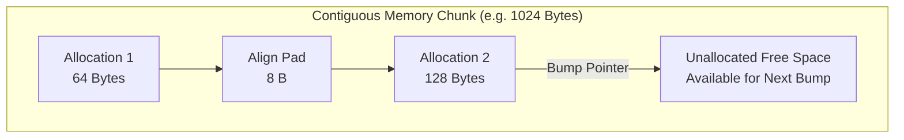

# Lesson 4: Custom Allocators: Bump and Arena Allocators

## Learning Goals
- Understand the architecture of specialized memory allocators.
- Implement a high-performance **Bump Allocator** from scratch.
- Understand the **Arena Allocator** pattern for bulk deallocation.
- Analyze alignment calculation bitwise arithmetic.

---

## 1. Theory: The Bump Allocator Pattern

Standard heap allocators (`malloc`) are general-purpose. They maintain complex data structures (free lists, bin trees, slab caches) to handle arbitrary allocation sizes and random deallocation orders. This introduces latency.

A **Bump Allocator** (or linear allocator) optimizes for speed:
- It maintains a single pointer (the bump offset) inside a contiguous block of pre-allocated memory.
- Every allocation simply advances (bumps) the pointer by the requested size (plus alignment padding).
- **Individual deallocations are no-ops**. You cannot free a single item.
- Reclaiming memory happens in bulk by resetting the bump pointer back to zero, or dropping the entire arena at once.

### Bitwise Alignment Calculation
To align an offset $P$ to alignment $A$ (where $A$ is a power of 2):
$$\text{AlignedOffset} = (P + A - 1) \ \& \ \sim(A - 1)$$
This operation takes just 2 CPU clock cycles.

---

## 2. Bump Allocation Diagram



---

## 3. Complete Rust Code Example

```rust
use std::alloc::{alloc, dealloc, Layout};
use std::cell::UnsafeCell;

pub struct ArenaAllocator {
    buffer: *mut u8,
    capacity: usize,
    offset: UnsafeCell<usize>,
}

unsafe impl Send for ArenaAllocator {}
unsafe impl Sync for ArenaAllocator {}

impl ArenaAllocator {
    pub fn new(capacity: usize) -> Self {
        let layout = Layout::from_size_align(capacity, 16).expect("Valid layout");
        // SAFETY: Allocate contiguous backing memory block with 16-byte alignment.
        let buffer = unsafe { alloc(layout) };
        assert!(!buffer.is_null(), "Backing buffer allocation failed");
        Self {
            buffer,
            capacity,
            offset: UnsafeCell::new(0),
        }
    }

    pub fn alloc(&self, layout: Layout) -> Option<*mut u8> {
        let current = unsafe { *self.offset.get() };
        let align = layout.align();
        let size = layout.size();

        // Compute aligned offset: (current + align - 1) & !(align - 1)
        let aligned = (current + (align - 1)) & !(align - 1);
        let next = aligned.checked_add(size)?;

        if next > self.capacity {
            return None; // Exceeds arena capacity
        }

        // SAFETY: Advance the internal offset and return the aligned pointer.
        unsafe {
            *self.offset.get() = next;
            Some(self.buffer.add(aligned))
        }
    }

    pub fn reset(&self) {
        // SAFETY: Bulk reclaim. Caller must guarantee all previous allocations are no longer referenced.
        unsafe {
            *self.offset.get() = 0;
        }
    }
}

impl Drop for ArenaAllocator {
    fn drop(&mut self) {
        let layout = Layout::from_size_align(self.capacity, 16).expect("Valid layout");
        // SAFETY: Deallocate backing buffer matching its creation layout.
        unsafe {
            dealloc(self.buffer, layout);
        }
    }
}

fn main() {
    let arena = ArenaAllocator::new(1024);

    let l1 = Layout::from_size_align(32, 8).unwrap();
    let p1 = arena.alloc(l1).expect("Alloc 1 succeeded");

    let l2 = Layout::from_size_align(64, 16).unwrap();
    let p2 = arena.alloc(l2).expect("Alloc 2 succeeded");

    println!("Allocated p1 at: {:p}", p1);
    println!("Allocated p2 at: {:p}", p2);

    // Reset arena memory
    arena.reset();
    println!("Arena reset successfully.");
}
```

---

## 4. Code Breakdown

1. `struct ArenaAllocator`:
   - Holds `buffer: *mut u8` pointing to the pre-allocated pool.
   - `UnsafeCell<usize>` enables interior mutability for the offset.
2. `alloc(&self, layout: Layout)`:
   - Reads current offset.
   - Applies the bitwise formula `(current + (align - 1)) & !(align - 1)` to align the pointer.
   - Verifies that `aligned + size <= capacity`.
   - Bumps the offset and returns `buffer.add(aligned)`.
3. `reset(&self)`:
   - Sets the offset back to 0. All memory is reclaimed simultaneously in $O(1)$ time.
4. `Drop for ArenaAllocator`:
   - Runs `dealloc` once on the backing chunk when the arena drops.

---

## 5. Best Practices

1. **Use Arenas for short-lived batch operations**: Compilers, game loop frames, and ray tracers use arenas because all resources for a frame or compilation unit are discarded together.
2. **Combine with RAII types carefully**: In a pure bump allocator, destructors (`Drop`) are not automatically called on individual items when resetting. If elements own external OS resources (like file handles or sockets), drop them explicitly before calling `reset()`.
3. **Avoid fragmentation**: Linear bump allocators suffer zero internal fragmentation except for alignment padding.

---

## 6. Common Errors

- **Dangling references after `reset()`**: Accessing an allocated pointer after calling `reset()` causes Use-After-Free.
  - *Fix*: Tie reference lifetimes to the arena lifetime using a typed reference arena pattern (e.g. `typed-arena` or `bumpalo`).
- **Ignoring alignment in bump offset**: Adding `size` directly without aligning `offset` causes misaligned pointer errors.
  - *Fix*: Always calculate `aligned_offset` using `layout.align()`.

---

## 7. Exercises

1. Modify `ArenaAllocator` to allocate chunks dynamically if the initial capacity is exhausted (a chained Arena Allocator).
2. Write a micro-benchmark comparing 10,000 allocations in `ArenaAllocator` versus 10,000 allocations with `Box::new()`.

---

## 8. Summary & Checklist

- [x] Bump allocators allocate in $O(1)$ time by advancing a single pointer.
- [x] Alignment is enforced using bitwise masking.
- [x] Bulk deallocation clears memory in $O(1)$ time with zero per-element overhead.
- [x] Callers must ensure references do not outlive the arena reset cycle.
