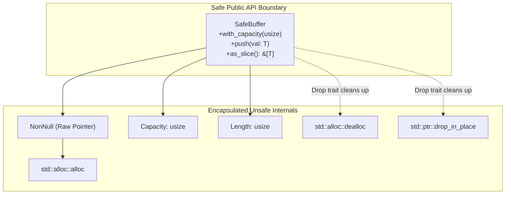

# Lesson 5: `ManuallyDrop`, `forget`, `leak`, and Safe Wrappers

## Learning Goals
- Understand destructor suppression with `ManuallyDrop<T>`, `std::mem::forget`, and `Box::leak`.
- Learn how to transfer ownership across FFI or hardware driver boundaries.
- Build safe RAII wrappers around manual raw allocations.
- Guarantee that every safety invariant is upheld by construction.

---

## 1. Theory: Destructor Suppression and RAII Boundaries

In Rust, the compiler automatically inserts destructor calls (`drop_in_place`) when variables leave scope.

In systems programming and driver development, there are times you must prevent automatic drops:
- Passing ownership to a C library or GPU driver that will manage or free the memory.
- Splitting a data structure into independent components (e.g. pointer, length, capacity).
- Ensuring memory is pinned at a fixed address forever (`'static`).

### Destructor Suppression Tools
1. **`ManuallyDrop<T>`**:
   - A zero-cost wrapper that inhibits compiler-generated calls to `Drop`.
   - Access to inner data is safe via `Deref`.
   - You can extract the inner value with `ManuallyDrop::take(slot)` or `into_inner()`.
2. **`std::mem::forget(val)`**:
   - Consumes `val` without running its destructor.
   - Any heap memory or OS handles owned by `val` are leaked unless freed manually.
3. **`Box::leak(b)`**:
   - Consumes `Box<T>` and returns a mutable reference `&'static mut T`.
   - Extremely useful for creating globally accessible static data at runtime.

---

## 2. RAII Wrapper Architecture Diagram



---

## 3. Complete Rust Code Example

```rust
use std::alloc::{alloc, dealloc, Layout};
use std::ptr::NonNull;

/// Safe educational RAII vector wrapper around manual raw memory.
pub struct SafeVector<T> {
    ptr: NonNull<T>,
    capacity: usize,
    len: usize,
}

impl<T> SafeVector<T> {
    pub fn with_capacity(capacity: usize) -> Self {
        assert!(capacity > 0, "Capacity must be positive");
        let layout = Layout::array::<T>(capacity).expect("Valid array layout");

        // SAFETY: Allocating memory for 'capacity' items of type T.
        let raw = unsafe { alloc(layout) as *mut T };
        let ptr = NonNull::new(raw).expect("Out of memory");

        Self {
            ptr,
            capacity,
            len: 0,
        }
    }

    pub fn push(&mut self, item: T) {
        assert!(self.len < self.capacity, "Buffer capacity exceeded");
        // SAFETY: self.ptr is non-null and valid. self.len is within capacity.
        unsafe {
            std::ptr::write(self.ptr.as_ptr().add(self.len), item);
        }
        self.len += 1;
    }

    pub fn as_slice(&self) -> &[T] {
        // SAFETY: Elements from 0 to self.len are fully initialized.
        unsafe { std::slice::from_raw_parts(self.ptr.as_ptr(), self.len) }
    }
}

impl<T> Drop for SafeVector<T> {
    fn drop(&mut self) {
        // SAFETY: Drop initialized items in place.
        for i in 0..self.len {
            unsafe {
                std::ptr::drop_in_place(self.ptr.as_ptr().add(i));
            }
        }
        let layout = Layout::array::<T>(self.capacity).expect("Valid array layout");
        // SAFETY: Free the raw buffer matching its initial allocation layout.
        unsafe {
            dealloc(self.ptr.as_ptr() as *mut u8, layout);
        }
    }
}

fn main() {
    let mut vec = SafeVector::with_capacity(2);
    vec.push(String::from("Safe"));
    vec.push(String::from("RAII"));

    for s in vec.as_slice() {
        println!("Stored: {}", s);
    }
    // vec drops here: String elements drop first, then the raw buffer is deallocated.
}
```

---

## 4. Code Breakdown

1. `SafeVector<T>` structure:
   - Private fields: `ptr: NonNull<T>`, `capacity`, `len`.
   - External callers cannot access the raw pointer directly, preserving safety invariants.
2. `push(&mut self, item: T)`:
   - Checks capacity to prevent buffer overflow.
   - Uses `std::ptr::write` to avoid dropping uninitialized bytes.
3. `as_slice(&self)`:
   - Safely returns `&[T]` because elements up to `self.len` are initialized and live.
4. `impl<T> Drop for SafeVector<T>`:
   - Two-phase cleanup:
     - Phase 1: Calls `std::ptr::drop_in_place` on each active element.
     - Phase 2: Calls `std::alloc::dealloc` on the backing buffer.

---

## 5. Best Practices

1. **Encapsulate unsafe code behind safe public interfaces**: Callers of `SafeVector` never need to write an `unsafe` block.
2. **Drop elements before freeing buffer memory**: If `T` owns resources (like sockets or heap pointers), freeing the buffer without dropping elements leaks those resources.
3. **Use `ManuallyDrop` rather than `std::mem::forget`**: `ManuallyDrop` is safer and easier to audit than `mem::forget`.
4. **Guard against panics in element destructors**: If an element's `drop` panics, continue cleaning up the remaining elements and free the buffer.

---

## 6. Common Errors

- **Leaking elements on container drop**: Calling `dealloc` without dropping each initialized element.
  - *Fix*: Iterate through initialized elements and call `std::ptr::drop_in_place`.
- **Using `*ptr = item` instead of `ptr::write`**: Direct assignment on uninitialized memory reads invalid data during drop.
  - *Fix*: Always use `std::ptr::write(ptr, item)`.

---

## 7. Exercises

1. Extend `SafeVector<T>` with a `pop(&mut self) -> Option<T>` method that uses `std::ptr::read` and decrements `len`.
2. Add a `clear(&mut self)` method that drops all active elements without deallocating the backing buffer.

---

## 8. Summary & Checklist

- [x] `ManuallyDrop` inhibits automatic destructor execution.
- [x] `std::ptr::write` initializes raw memory without reading old bits.
- [x] `std::ptr::drop_in_place` runs destructors on raw memory elements.
- [x] Safe wrappers encapsulate unsafe internals behind clean public APIs.
