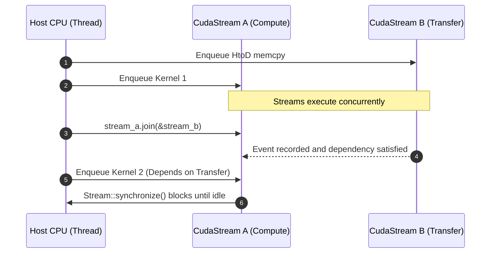

# Lesson 1: CUDA Context and CUDA Stream (`cuda-core`)

## Learning Goals
- Understand the CUDA Driver architecture and the role of `CudaContext`.
- Learn how `CudaStream` manages asynchronous execution queues on the GPU.
- Master stream priority configuration and non-blocking streams.
- Construct stream Directed Acyclic Graphs (DAGs) using `join` and `record_event`.

---

## 1. Theory: Contexts and Streams in `cuda-rust`

The NVIDIA CUDA platform exposes device execution through two core abstractions in `cuda-core`:

### `CudaContext`
A `CudaContext` represents the execution context on a physical GPU device (similar to a process on the host CPU).
- It manages device memory mappings, page tables, loaded PTX/cubin modules, and texture references.
- `Context::new(ordinal)` initializes the primary context for the specified GPU ordinal.
- It provides RAII management: dropping the `Context` automatically releases driver resources.

### `CudaStream`
A `CudaStream` is a sequence of asynchronous commands executed in order by the GPU.
- Commands enqueued on the same stream execute serially (FIFO).
- Commands enqueued on different streams can execute concurrently or out of order.
- In `cuda-core`, streams are created via `context.new_stream()`.
- Streams maintain an internal handle pool to avoid expensive driver creation/destruction calls.

### Stream Fork and Join
To coordinate dependencies between independent streams:
- `stream_b.join(&stream_a)` records an internal CUDA event on `stream_a` and inserts an event wait into `stream_b`.
- Operations enqueued on `stream_b` will wait until all prior operations on `stream_a` complete.

---

## 2. Stream Execution Sequence Diagram



---

## 3. Complete Rust Code Example

```rust
use common::{EduContext, EduStream};
use std::sync::Arc;

fn main() -> Result<(), String> {
    // 1. Initialize CUDA context for GPU ordinal 0
    let context: Arc<EduContext> = EduContext::new(0)?;
    println!("CUDA Context initialized on GPU ordinal: {}", context.ordinal());

    // 2. Create two independent streams
    let stream_a: Arc<EduStream> = context.new_stream()?;
    let stream_b: Arc<EduStream> = context.new_stream()?;

    // 3. In native cuda-core, you can query priority or fork streams:
    // let stream_fork = stream_a.fork()?;
    // stream_b.join(&stream_a)?;

    // 4. Synchronize streams before teardown
    stream_a.synchronize()?;
    stream_b.synchronize()?;

    println!("All streams synchronized successfully.");
    Ok(())
}
```

---

## 4. Code Breakdown

1. `EduContext::new(0)` (or `cuda_core::Context::new(0)`):
   - Binds to GPU device 0.
   - Retains the driver primary context.
2. `context.new_stream()`:
   - Creates a non-blocking CUDA stream.
   - The returned `Arc<Stream>` owns the underlying `CUstream` handle.
3. Concurrency semantics:
   - Work enqueued on `stream_a` and `stream_b` runs concurrently across independent hardware warp schedulers on the GPU.
4. `synchronize()`:
   - Blocks the host CPU thread until the stream has cleared all enqueued tasks.

---

## 5. Best Practices

1. **Use separate streams for memory copies and kernel compute**: This enables full bidirectional copy-compute overlap on GPUs with multiple copy engines.
2. **Avoid default stream 0 for asynchronous pipelines**: The legacy default stream synchronizes implicitly with all other streams. Use explicit non-blocking streams created via `context.new_stream()`.
3. **Use events for fine-grained dependency tracking**: Instead of synchronizing the host CPU (`stream.synchronize()`), use `stream_b.join(&stream_a)` to keep synchronization entirely on the GPU.
4. **Tie buffer lifetimes to stream completion**: Never drop or reuse host buffers participating in asynchronous copies before the stream synchronizes.

---

## 6. Common Errors

- **Cross-context handle mixing**: Passing a stream belonging to GPU 0 to an operation expecting GPU 1.
  - *Fix*: `cuda-core` checks context identity and returns `CUDA_ERROR_INVALID_CONTEXT`.
- **CPU busy-waiting**: Spinning on `stream.query()` in a tight loop instead of using event callbacks or `synchronize()`.
  - *Fix*: Call `stream.synchronize()` to yield the CPU thread cleanly.

---

## 7. Exercises

1. Create a script that initializes two streams, simulates an asynchronous copy on stream A, a kernel launch on stream B, and joins stream B with stream A.
2. Explain why reusing a stream handle from a stream pool is faster than creating a new `cuStreamCreate` on every iteration.

---

## 8. Summary & Checklist

- [x] `CudaContext` manages device state, memory, and module loading.
- [x] `CudaStream` provides an asynchronous FIFO command queue for GPU work.
- [x] Independent streams enable concurrent execution of memory copies and compute kernels.
- [x] `join` and `record_event` construct dependency graphs without blocking the host CPU.
