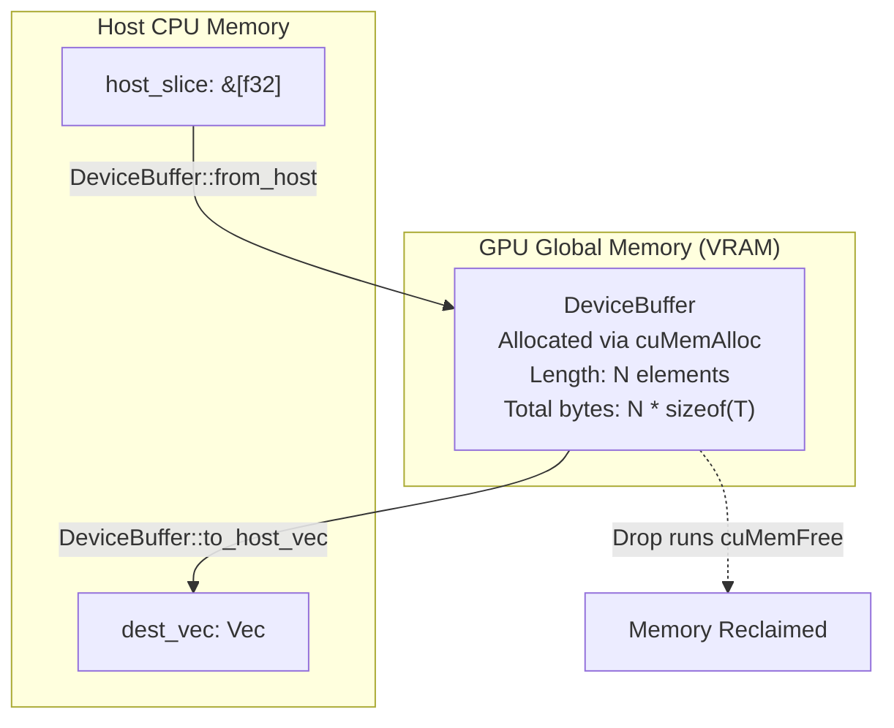

# Lesson 2: The `DeviceBuffer<T>` Abstraction

## Learning Goals
- Understand the `DeviceBuffer<T>` type and its role as the GPU equivalent of `Vec<T>`.
- Learn the `DeviceCopy` marker trait and understand why types with drop glue are rejected.
- Master buffer constructors: `from_host`, `zeroed`, and `to_host_vec`.
- Understand synchronous `cuMemFree` drop behavior vs asynchronous lease tracking.

---

## 1. Theory: Safe GPU Memory Buffers

In standard CUDA C++, device pointers are raw addresses (`float* dev_ptr`). Memory leaks and dangling pointers are frequent bugs.

In `cuda-core`, the central owning abstraction is `DeviceBuffer<T>`:
- Represents a contiguous, typed allocation of $N$ elements on device global memory (`cuMemAlloc`).
- Owns the device memory allocation and the owning `Context`.
- Bounded by the unsafe marker trait `DeviceCopy`. Only plain-old-data (POD) types with no host pointers or drop semantics can be allocated on the GPU.
- Automatically releases device memory on `Drop` via `cuMemFree`.

### The `DeviceCopy` Trait Invariants
Types implementing `DeviceCopy` must satisfy:
1. Safe to duplicate bitwise (byte-for-byte copy).
2. The all-zero bit pattern must represent a valid value (because `zeroed()` uses `cuMemsetD8`).
3. Must not contain host pointers or Rust ownership types (e.g., `String`, `Box`, `Vec` are rejected at compile time).

---

## 2. Allocation and Ownership Lifecycle



---

## 3. Complete Rust Code Example

```rust
use common::{EduContext, EduDeviceBuffer, EduStream};
use std::sync::Arc;

fn main() -> Result<(), String> {
    // 1. Setup CUDA context and stream
    let context: Arc<EduContext> = EduContext::new(0)?;
    let stream: Arc<EduStream> = context.new_stream()?;

    // 2. Allocate and upload from host slice
    let host_input = vec![1.0f32, 2.0, 3.0, 4.0];
    let dev_buffer = EduDeviceBuffer::from_host(&stream, &host_input)?;

    println!("DeviceBuffer allocated: len = {}, bytes = {}",
        dev_buffer.len(), dev_buffer.num_bytes());

    // 3. Allocate zero-initialized device buffer
    let dev_zeroed = EduDeviceBuffer::<f32>::zeroed(&stream, 4)?;

    // 4. Download device memory back to host
    let host_output = dev_buffer.to_host_vec(&stream)?;
    assert_eq!(host_output, host_input);

    let zero_output = dev_zeroed.to_host_vec(&stream)?;
    assert_eq!(zero_output, vec![0.0, 0.0, 0.0, 0.0]);

    println!("Host-Device roundtrip verified successfully.");

    // dev_buffer and dev_zeroed drop here, safely calling cuMemFree
    Ok(())
}
```

---

## 4. Code Breakdown

1. `EduDeviceBuffer::from_host(&stream, &host_input)`:
   - Takes reference to stream and host data slice.
   - Allocates GPU global memory (`cuMemAlloc`).
   - Enqueues host-to-device copy (`cuMemcpyHtoDAsync`).
   - Synchronizes stream to ensure the host slice can be safely modified or dropped immediately afterward.
2. `EduDeviceBuffer::zeroed(&stream, 4)`:
   - Allocates device memory and calls `cuMemsetD8Async` to zero every byte.
3. `dev_buffer.to_host_vec(&stream)`:
   - Allocates a host `Vec<T>`.
   - Copies data from device to host (`cuMemcpyDtoHAsync`).
   - Synchronizes stream before returning the filled vector.
4. `Drop for DeviceBuffer`:
   - When the buffer leaves scope, its `Drop` implementation calls `cuMemFree` to return device memory to the driver pool.

---

## 5. Best Practices

1. **Prefer `DeviceBuffer` for standard single-stream workloads**: It provides automatic RAII deallocation without manual cleanup.
2. **Never store host pointers in GPU structs**: Ensure any custom struct used in `DeviceBuffer<T>` implements `DeviceCopy` and has `#[repr(C)]`.
3. **Use `zeroed` for output buffers**: Prevents kernels from reading stale GPU memory left by other processes.
4. **Avoid allocating `DeviceBuffer` inside high-frequency loops**: Dynamic device allocation (`cuMemAlloc`) synchronizes driver locks. Allocate buffers upfront and reuse them across iterations.

---

## 6. Common Errors

- **Attempting to allocate `DeviceBuffer<String>`**:
  - Compiler error: `String does not implement DeviceCopy`.
  - *Fix*: Store primitive byte buffers (`u8`) or fixed-size numeric arrays on the GPU.
- **Dropping a buffer while a kernel is still executing**:
  - In raw CUDA C, `cudaFree` blocks until all streams are idle or triggers an error.
  - *Fix*: In `cuda-core`, safe launch APIs retain access leases until stream execution completes.

---

## 7. Exercises

1. Define a custom struct `Point3D` containing three `f32` coordinates. Annotate it with `#[repr(C)]`, implement `Copy`, and mark it as `unsafe impl DeviceCopy`. Allocate a `DeviceBuffer<Point3D>` and download it.
2. What happens if you try to implement `DeviceCopy` for `Option<Box<i32>>`? Explain why this violates the safety contract.

---

## 8. Summary & Checklist

- [x] `DeviceBuffer<T>` is the RAII owner of GPU global memory in `cuda-core`.
- [x] Only types implementing `DeviceCopy` can reside in device buffers.
- [x] `from_host` and `to_host_vec` simplify bidirectional host-device data movement.
- [x] Drop automatically reclaims device memory via `cuMemFree`.
