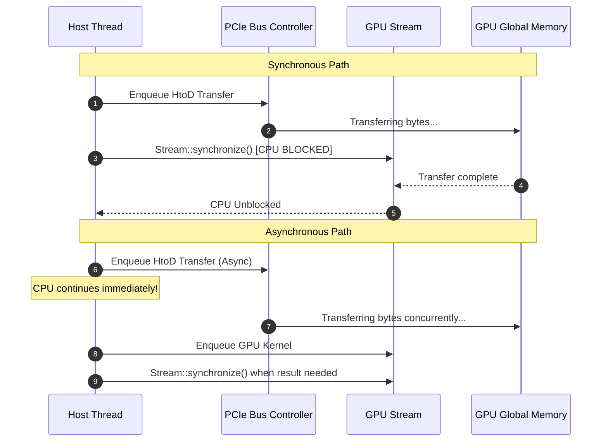

# Lesson 3: Host-to-Device and Device-to-Host Memory Copies

## Learning Goals
- Understand PCIe data transfer mechanics between host CPU RAM and GPU VRAM.
- Master explicit synchronous transfers vs non-blocking asynchronous transfers.
- Learn the safety contracts of `from_host_async_unchecked` and `copy_to_pinned_host_async`.
- Prevent data corruption caused by premature host buffer reuse.

---

## 1. Theory: Host-Device Data Transfers

Data cannot be operated on by GPU ALUs while it resides in host CPU memory. It must travel over the PCIe (or NVLink) bus into GPU High Bandwidth Memory (HBM/GDDR).

### Synchronous Transfers
- Methods like `DeviceBuffer::from_host` or `copy_to_host`:
  1. Enqueue the copy command onto the target `CudaStream`.
  2. Block the host CPU thread until the PCIe transfer completes (`stream.synchronize()`).
  3. Safe for arbitrary host slices because the host slice is guaranteed idle when the function returns.

### Asynchronous Transfers
- Methods like `DeviceBuffer::from_host_async_unchecked` or `copy_from_host_async_unchecked`:
  1. Enqueue the copy command onto the target `CudaStream`.
  2. Return immediately to the host CPU thread while the transfer is still in flight on the PCIe bus.
  3. **Unsafe Contract**: The caller must guarantee that the source host buffer is not modified, dropped, or aliased until the stream synchronizes.

---

## 2. Transfer Timeline Diagram



---

## 3. Complete Rust Code Example

```rust
use common::{EduContext, EduDeviceBuffer, EduStream};
use std::sync::Arc;

fn main() -> Result<(), String> {
    let context: Arc<EduContext> = EduContext::new(0)?;
    let stream: Arc<EduStream> = context.new_stream()?;

    // 1. Initial host data
    let host_source = vec![10u32, 20, 30, 40, 50];

    // 2. Synchronous copy: Safe and convenient
    let mut dev_buffer = EduDeviceBuffer::from_host(&stream, &host_source)?;

    // 3. Modifying data directly on the device
    // (Simulating device work)
    let update_host = vec![100u32, 200, 300, 400, 500];
    let dev_update = EduDeviceBuffer::from_host(&stream, &update_host)?;

    // 4. Download result back to host
    let mut downloaded = vec![0u32; 5];
    let result = dev_update.to_host_vec(&stream)?;
    downloaded.copy_from_slice(&result);

    println!("Downloaded values from GPU: {:?}", downloaded);
    assert_eq!(downloaded, update_host);

    Ok(())
}
```

---

## 4. Code Breakdown

1. `EduDeviceBuffer::from_host(&stream, &host_source)`:
   - Allocates device buffer of size `host_source.len() * 4` bytes.
   - Submits `memcpy_htod_async` to the GPU stream.
   - Synchronizes stream before returning.
2. In native `cuda-core`:
   - `dev_buf.copy_from_host(&stream, &[...])` refills an existing device buffer without triggering a new device allocation.
   - Synchronizes the stream, ensuring the host slice is safe for immediate reuse.
3. `dev_update.to_host_vec(&stream)`:
   - Reads data from device pointer to host vector (`memcpy_dtoh_async`).
   - Synchronizes stream before returning the vector.

---

## 5. Best Practices

1. **Batch transfers into large contiguous blocks**: PCIe latency dominates small transfers. Transferring one 64 MB buffer is much faster than transferring 1,000 buffers of 64 KB.
2. **Reuse existing `DeviceBuffer` allocations with `copy_from_host`**: Avoid calling `from_host` in a loop; allocate once and copy into the existing buffer.
3. **Use Pinned Memory for asynchronous transfers**: Pageable host memory cannot achieve true asynchronous overlap because the CUDA driver must first copy it into an internal pinned staging buffer.
4. **Never drop the source buffer during asynchronous copies**: If using `_async_unchecked` methods, hold the host buffer alive until an event or stream synchronization confirms completion.

---

## 6. Common Errors

- **Use-After-Free during async copy**: Dropping a host `Vec` while an asynchronous `from_host_async_unchecked` copy is still reading it.
  - *Fix*: Keep the host vector alive until calling `stream.synchronize()`.
- **Buffer size mismatch**: Passing a destination slice smaller than `dev_buffer.len()`.
  - *Fix*: Pre-allocate destination slices to match or exceed buffer length.

---

## 7. Exercises

1. Measure the bandwidth difference (in GB/s) between transferring 1,000 elements individually versus transferring an array of 1,000,000 elements in a single call.
2. Write a function that refills a `DeviceBuffer<f32>` with new data on every iteration of a loop without reallocating device memory.

---

## 8. Summary & Checklist

- [x] Host-device copies transfer memory across the PCIe bus.
- [x] Synchronous copies block the host CPU until transfer completion.
- [x] Asynchronous copies allow CPU computation to overlap with PCIe transfer.
- [x] Reusing device allocations minimizes driver overhead.
