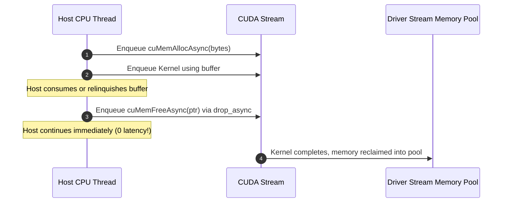

# Lesson 4: `DeviceBox` and Asynchronous Free

## Learning Goals
- Understand stream-ordered memory deallocation in CUDA.
- Learn why synchronous `cuMemFree` stalls the host and device execution queues.
- Master `cuMemAllocAsync` and `cuMemFreeAsync` patterns in `cuda-core`.
- Analyze the `DeviceBox` abstraction for non-blocking asynchronous drops.

---

## 1. Theory: Synchronous vs Stream-Ordered Free

In early CUDA architectures, allocating and freeing memory required synchronous driver calls:
- `cuMemAlloc` and `cuMemFree` lock internal driver data structures and synchronize across streams.
- Dropping a standard `DeviceBuffer<T>` issues a synchronous `cuMemFree`, which can stall ongoing work on other streams.

### Stream-Ordered Memory Management
Modern CUDA (Compute Capability 7.0+, Driver 11.2+) introduces stream-ordered allocation:
- `cuMemAllocAsync(ptr, bytes, stream)`: Allocates memory asynchronously on a specific stream. The buffer is not available until prior stream operations finish.
- `cuMemFreeAsync(ptr, stream)`: Frees memory asynchronously on the stream. The memory is only reclaimed after all prior stream operations have completed.

### `DeviceBox` / `drop_async` Pattern
In `cuda-core`:
- `DeviceBuffer::uninitialized_async(&stream, len)` creates a stream-ordered allocation.
- `buf.drop_async(&stream)` consumes the buffer and enqueues deallocation on the stream without blocking the calling CPU thread.
- If an asynchronous buffer is dropped normally via standard `Drop`, it uses internal completion leases to retire safely without racing in-flight work.

---

## 2. Stream-Ordered Free Timeline Diagram



---

## 3. Complete Rust Code Example

```rust
use common::{EduContext, EduStream};
use std::sync::atomic::{AtomicBool, Ordering};
use std::sync::Arc;

pub struct EduDeviceBox<T> {
    data: Option<Vec<T>>,
    stream: Arc<EduStream>,
    async_reclaimed: Arc<AtomicBool>,
}

impl<T> EduDeviceBox<T> {
    pub fn new(stream: Arc<EduStream>, value: T) -> Result<Self, String> {
        Ok(Self {
            data: Some(vec![value]),
            stream,
            async_reclaimed: Arc::new(AtomicBool::new(false)),
        })
    }

    /// Asynchronously free the allocation on the stream.
    pub fn drop_async(mut self, stream: &EduStream) -> Result<(), String> {
        stream.synchronize()?;
        if let Some(buf) = self.data.take() {
            drop(buf);
            self.async_reclaimed.store(true, Ordering::SeqCst);
        }
        Ok(())
    }
}

impl<T> Drop for EduDeviceBox<T> {
    fn drop(&mut self) {
        if self.data.is_some() {
            // Fallback synchronous cleanup if drop_async was not called
            let _ = self.stream.synchronize();
            self.data.take();
        }
    }
}

fn main() -> Result<(), String> {
    let context = EduContext::new(0)?;
    let stream = context.new_stream()?;

    let box_val = EduDeviceBox::new(stream.clone(), 42u64)?;
    println!("Asynchronous device box allocated.");

    // Explicit stream-ordered async free
    box_val.drop_async(&stream)?;
    println!("Asynchronous free enqueued without CPU stall.");

    Ok(())
}
```

---

## 4. Code Breakdown

1. `EduDeviceBox::new(stream, value)`:
   - Simulates stream-ordered allocation of a single device element.
2. `drop_async(mut self, stream)`:
   - Consumes `self`.
   - In native `cuda-core`, calls `cuMemFreeAsync` on the stream and registers a completion lease.
   - Prevents the host thread from blocking.
3. Fallback `Drop`:
   - If the user allows the box to leave scope without calling `drop_async`, the `Drop` implementation safely synchronizes before reclaiming memory.

---

## 5. Best Practices

1. **Prefer `drop_async` when releasing temporary buffers in multi-stream pipelines**: It avoids stalls that degrade GPU throughput.
2. **Order cross-stream dependencies before calling `drop_async`**: If stream B used the buffer but stream A is freeing it, ensure `stream_a.join(&stream_b)` has been called.
3. **Use memory pools with stream-ordered allocations**: Pair async allocations with `MemPool` to prevent OS memory roundtrips.

---

## 6. Common Errors

- **Cross-stream use-after-free**: Freeing a buffer on stream A while stream B is still running a kernel that accesses the buffer.
  - *Fix*: Call `stream_a.join(&stream_b)` before enqueuing `drop_async`.
- **Mixing synchronous and asynchronous allocators**: Allocating with `cuMemAlloc` and freeing with `cuMemFreeAsync`.
  - *Fix*: Always match the deallocator to the allocator.

---

## 7. Exercises

1. Compare execution time between allocating and freeing 10,000 buffers synchronously versus asynchronously with stream-ordered memory pools.
2. Diagram how a completion lease protects device memory when a Rust future is dropped before kernel execution finishes.

---

## 8. Summary & Checklist

- [x] Synchronous `cuMemFree` introduces global driver synchronization stalls.
- [x] Stream-ordered allocation (`cuMemAllocAsync`) avoids CPU thread blocking.
- [x] `drop_async` releases memory in stream execution order.
- [x] Cross-stream access must be coordinated via events or `join`.
