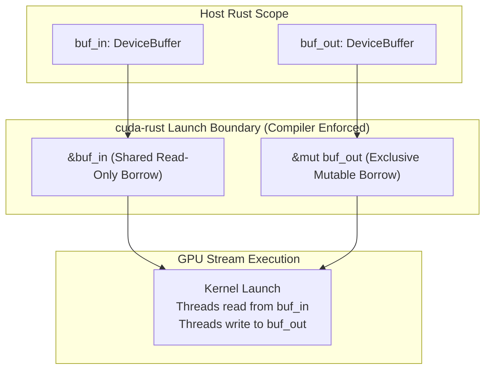

# Lesson 5: Ownership and the GPU Launch Boundary

## Learning Goals
- Understand how Rust ownership and borrow rules cross the host-device boundary.
- Learn how `cuda-rust` prevents GPU data races at compile time.
- Master immutable borrowing for shared device inputs.
- Master exclusive mutable borrowing for device output buffers.

---

## 1. Theory: The Host-Device Launch Contract

In standard CUDA C++, the launch boundary is an unchecked unsafe barrier:
```cpp
my_kernel<<<grid, block, 0, stream>>>(d_in, d_out);
```
Nothing stops the C++ developer from launching another kernel that mutates `d_in` concurrently on a different stream, causing silent, non-deterministic data races on the GPU.

### How `cuda-rust` Extends Ownership to the GPU
In `cuda-rust` (both `cuda-oxide` and `cutile-rs`), the kernel launch syntax enforces Rust's borrow checker across GPU streams:
1. **Shared Buffers (`&DeviceBuffer<T>`)**:
   - Multiple kernels can read from the buffer concurrently across any number of streams.
   - Rust prevents any code from mutating or deallocating the buffer while borrowed.
2. **Mutable Buffers (`&mut DeviceBuffer<T>`)**:
   - Exactly one kernel can hold a mutable borrow of the buffer.
   - No other kernel or host operation can read or write to that buffer while the borrow is active.
3. **Liveness Retention**:
   - The kernel launcher retains the borrow for the entire duration that GPU work is in flight.

This eliminates GPU data races by construction!

---

## 2. Launch Boundary Ownership Diagram



---

## 3. Complete Rust Code Example

```rust
use common::{EduContext, EduDeviceBuffer, EduStream};
use std::sync::Arc;

/// A safe kernel launch wrapper enforcing Rust ownership rules.
fn launch_elementwise_add(
    stream: &EduStream,
    a: &EduDeviceBuffer<f32>,
    b: &EduDeviceBuffer<f32>,
    out: &mut EduDeviceBuffer<f32>,
) -> Result<(), String> {
    assert_eq!(a.len(), b.len());
    assert_eq!(a.len(), out.len());

    // In native cuda-oxide, the macro invocation looks like:
    // unsafe {
    //     cuda_module::add_kernel::launch(stream, config, a, b, out)?;
    // }
    // Rust ensures 'out' cannot alias 'a' or 'b' because 'out' is an exclusive borrow!

    unsafe {
        let p_a = a.as_device_ptr();
        let p_b = b.as_device_ptr();
        let p_out = out.as_device_ptr();

        for i in 0..a.len() {
            *p_out.add(i) = *p_a.add(i) + *p_b.add(i);
        }
    }

    stream.synchronize()?;
    Ok(())
}

fn main() -> Result<(), String> {
    let context = EduContext::new(0)?;
    let stream = context.new_stream()?;

    let in_a = EduDeviceBuffer::from_host(&stream, &[1.0f32, 2.0, 3.0, 4.0])?;
    let in_b = EduDeviceBuffer::from_host(&stream, &[10.0f32, 20.0, 30.0, 40.0])?;
    let mut out = EduDeviceBuffer::<f32>::zeroed(&stream, 4)?;

    // Shared borrows for inputs, exclusive borrow for output
    launch_elementwise_add(&stream, &in_a, &in_b, &mut out)?;

    let result = out.to_host_vec(&stream)?;
    println!("Kernel execution output: {:?}", result);
    assert_eq!(result, vec![11.0, 22.0, 33.0, 44.0]);

    Ok(())
}
```

---

## 4. Code Breakdown

1. `fn launch_elementwise_add(..., a: &EduDeviceBuffer, ..., out: &mut EduDeviceBuffer)`:
   - `a` and `b` are passed by immutable reference `&`. They can be shared freely across other concurrent streams.
   - `out` is passed by mutable reference `&mut`. The compiler guarantees that no other thread or stream has access to `out`.
2. Compile-Time Race Prevention:
   - If a developer tries to pass `&mut out` to two kernel launches simultaneously, the Rust compiler rejects the code with:
     `cannot borrow out as mutable more than once at a time`.
3. Synchronization:
   - The stream synchronization guarantees the device work completes before mutable references are released back to the host.

---

## 5. Best Practices

1. **Borrow immutably across kernels**: If multiple kernels read the same model weights or constant tables, pass `&DeviceBuffer` to all of them.
2. **Never alias mutable device buffers**: Do not pass the same buffer as both input and output unless the kernel is explicitly designed for in-place mutation on `&mut`.
3. **Partition mutable buffers for parallel writes**: If multiple warps or blocks must write into the same buffer, partition the buffer using disjoint slices rather than raw pointer casting.
4. **Keep stream operations ordered**: Ensure that any dependencies between kernel launches are established via events or streams before dropping buffers.

---

## 6. Common Errors

- **Attempting concurrent writes to the same buffer**:
  - In C++, launching two kernels writing to the same pointer causes silent corruption.
  - In `cuda-rust`, the borrow checker statically prevents this bug.
- **Dropping a buffer before kernel completes**:
  - `cuda-core` launchers keep access leases alive on the stream until execution finishes.

---

## 7. Exercises

1. Write a kernel launcher that performs in-place scaling on `&mut DeviceBuffer<f32>`.
2. Try to pass the same `&mut DeviceBuffer<f32>` as both the first and second argument to a function. Observe the compiler error and document the borrow checker's response.

---

## 8. Summary & Checklist

- [x] `cuda-rust` extends Rust ownership and borrowing across the GPU launch boundary.
- [x] Immutable borrows (`&DeviceBuffer`) allow safe concurrent reads across streams.
- [x] Mutable borrows (`&mut DeviceBuffer`) prevent data races on GPU output buffers.
- [x] Kernel launchers keep access leases alive until GPU work finishes.
