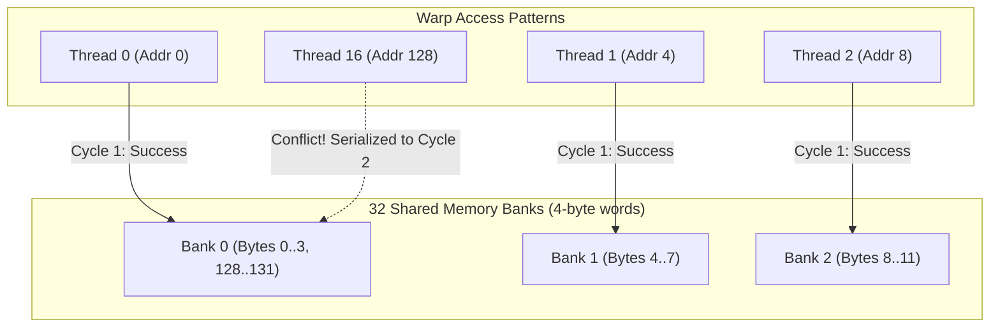

# Lesson 1: GPU Shared Memory Architecture and Bank Conflicts

## Learning Goals
- Understand on-chip Shared Memory architecture in NVIDIA Streaming Multiprocessors (SMs).
- Compare static shared memory arrays with dynamic shared memory.
- Learn the physics of shared memory banks (32 banks, 4 bytes per bank).
- Detect and prevent shared memory bank conflicts.

---

## 1. Theory: The Shared Memory Hierarchy

Shared memory is high-speed, on-chip SRAM located directly inside each Streaming Multiprocessor (SM).
- Latency: ~20-30 cycles (compared to ~400-800 cycles for global VRAM).
- Shared memory is scoped to a **Thread Block**. All threads within a block can read and write to this memory space.
- Different thread blocks cannot access each other's shared memory.
- Shared memory disappears when the block finishes execution.

### Static vs Dynamic Shared Memory
1. **Static Shared Memory**:
   - Size is known at compile time.
   - Declared as fixed arrays (e.g. `__shared__ float smem[256]` in CUDA C or `SharedArray<T, N>` in `cuda-oxide`).
2. **Dynamic Shared Memory**:
   - Size is configured at kernel launch time via `LaunchConfig.shared_mem_bytes`.
   - In `cuda-core`, checked against device limits via `LaunchContractSpec`.

### Shared Memory Banks and Bank Conflicts
Shared memory is divided into **32 memory banks** of 4 bytes (32 bits) each:
$$\text{Bank Index} = \left(\frac{\text{Byte Address}}{4}\right) \pmod{32}$$
- When multiple threads in the same warp access addresses in **distinct banks**, requests execute in a single memory cycle.
- When two or more threads in a warp access different addresses within the **same bank**, a **Bank Conflict** occurs. The hardware serializes the accesses, degrading throughput.
- Exception: Broadcast. When all threads in a warp read the *exact same address*, no conflict occurs.

---

## 2. Shared Memory Bank Conflict Diagram



---

## 3. Complete Rust Code Example

```rust
// Educational demonstration of Bank Conflict computation in Rust

fn compute_bank_index(byte_offset: usize) -> usize {
    // 32 banks, each 4 bytes wide
    (byte_offset / 4) % 32
}

fn check_warp_bank_conflicts(stride_elements: usize) -> (usize, bool) {
    let mut bank_counts = [0usize; 32];
    let elem_size = std::mem::size_of::<f32>(); // 4 bytes

    // 32 threads in a standard NVIDIA warp
    for thread_id in 0..32 {
        let byte_offset = thread_id * stride_elements * elem_size;
        let bank = compute_bank_index(byte_offset);
        bank_counts[bank] += 1;
    }

    let max_conflicts = *bank_counts.iter().max().unwrap();
    let has_conflict = max_conflicts > 1;
    (max_conflicts, has_conflict)
}

fn main() {
    // Stride 1: Thread 0 -> Bank 0, Thread 1 -> Bank 1, Thread 31 -> Bank 31 (Zero conflicts)
    let (c1, conflict1) = check_warp_bank_conflicts(1);
    println!("Stride 1 (Linear access): max conflicts = {}, has_conflict = {}", c1, conflict1);
    assert_eq!(c1, 1);

    // Stride 2: 2-way bank conflict (Threads 0 and 16 hit Bank 0)
    let (c2, conflict2) = check_warp_bank_conflicts(2);
    println!("Stride 2 access: max conflicts = {}, has_conflict = {}", c2, conflict2);
    assert_eq!(c2, 2);

    // Stride 32: 32-way bank conflict! All 32 threads hit Bank 0! (Fully serialized)
    let (c32, conflict32) = check_warp_bank_conflicts(32);
    println!("Stride 32 access: max conflicts = {}, has_conflict = {}", c32, conflict32);
    assert_eq!(c32, 32);
}
```

---

## 4. Code Breakdown

1. `compute_bank_index`:
   - Simulates the physical mapping of byte addresses to the 32 hardware banks.
2. Stride 1 Access:
   - Successive threads access consecutive 4-byte floats. Every thread hits a distinct bank. Peak throughput.
3. Stride 2 and Stride 32 Access:
   - Stride 2 causes threads 0 and 16 to target the same bank, cutting memory bandwidth in half.
   - Stride 32 forces all 32 threads to the same bank, resulting in 32 serialized memory cycles.
4. Padding Solution:
   - In matrix transpose kernels, adding 1 element of padding per row (e.g., `smem[32][33]`) shifts row alignments and eliminates stride-32 conflicts.

---

## 5. Best Practices

1. **Pad shared memory arrays**: Add dummy padding elements to 2D shared tiles to prevent stride power-of-two bank collisions.
2. **Synchronize warps with `syncthreads()`**: Always execute an explicit block barrier before reading data written to shared memory by other threads.
3. **Use shared memory as an L1 staging cache**: Load global memory coalesced into shared memory once, then perform multiple computations from shared memory.
4. **Query opt-in limits before requesting >48 KiB**: Devices default to 48 KiB per block; larger allocations require opting in via driver function attributes.

---

## 6. Common Errors

- **Missing barrier synchronization**: Reading shared memory before all threads finish writing causes data races.
  - *Fix*: Call block-level barrier synchronization (`syncthreads`).
- **Exceeding shared memory limits**: Requesting more bytes than the SM supports causes launch failures (`CUDA_ERROR_OUT_OF_MEMORY`).
  - *Fix*: Use `PreparedLaunch` in `cuda-core` to validate shared memory limits at compile/prepare time.

---

## 7. Exercises

1. Calculate the bank index for thread 5 reading `f32` at index 64.
2. Write a function that demonstrates how adding 1 element of padding to a $32 \times 32$ matrix stored in shared memory eliminates bank conflicts.

---

## 8. Summary & Checklist

- [x] Shared memory provides fast on-chip SRAM shared across threads in a block.
- [x] 32 hardware banks serve memory requests simultaneously.
- [x] Different threads accessing the same bank cause serialized bank conflicts.
- [x] Array padding and linear access patterns eliminate bank conflicts.
