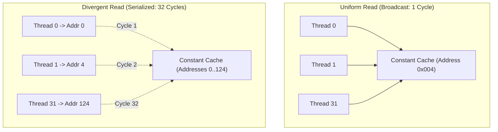

# Lesson 2: Constant Memory and Hardware Broadcast

## Learning Goals
- Understand GPU Constant Memory space (64 KiB total limit).
- Learn the hardware warp broadcast mechanism.
- Master warp divergence penalties vs uniform reads in constant memory.
- Use `ConstantHandle` in `cuda-core` to update constant tables from the host.

---

## 1. Theory: Constant Memory and Warp Broadcast

Constant memory is a dedicated 64 KiB read-only memory space residing in device VRAM, backed by an on-chip **constant cache** in each SM:
- **Optimal Access Pattern**: When all 32 threads in a warp read the **same memory address**, the hardware broadcasts the value to all threads in a **single cycle**.
- **Worst-Case Access Pattern**: When all 32 threads in a warp read 32 **different addresses**, the constant cache serializes the requests into 32 consecutive reads.

### Constant Memory in `cuda-core`
In `cuda-core`:
- Global constants declared in PTX/cubin modules are represented by `ConstantHandle<T>`.
- The host CPU updates constant memory using `module.get_constant("CONST_NAME")` and calling `copy_from_host(&stream, &[...])`.
- Kernels can read the table with zero address calculation overhead.

---

## 2. Warp Broadcast vs Serialized Read Diagram



---

## 3. Complete Rust Code Example

```rust
use common::{EduContext, EduStream};
use std::sync::Arc;

/// Educational representation of Constant Memory Table
pub struct EduConstantTable<T: Copy, const N: usize> {
    data: [T; N],
}

impl<T: Copy + Default, const N: usize> EduConstantTable<T, N> {
    pub fn new() -> Self {
        assert!(N * std::mem::size_of::<T>() <= 65536, "Exceeds 64 KiB constant memory limit");
        Self {
            data: [T::default(); N],
        }
    }

    /// Host update of constant table
    pub fn update(&mut self, values: &[T]) {
        assert!(values.len() <= N, "Values exceed constant table capacity");
        self.data[..values.len()].copy_from_slice(values);
    }

    /// Simulates warp broadcast access
    pub fn read_broadcast(&self, index: usize) -> T {
        // Single memory read broadcast to all threads in warp
        self.data[index]
    }
}

fn main() -> Result<(), String> {
    let context = EduContext::new(0)?;
    let stream = context.new_stream()?;

    // Create 16-element filter kernel coefficients (convolution weights)
    let mut filter_weights = EduConstantTable::<f32, 16>::new();
    filter_weights.update(&[0.1, 0.2, 0.4, 0.2, 0.1]);

    // All threads in warp reading coefficient 2 get single-cycle broadcast
    let val = filter_weights.read_broadcast(2);
    println!("Broadcasted constant coefficient: {}", val);
    assert_eq!(val, 0.4);

    stream.synchronize()?;
    Ok(())
}
```

---

## 4. Code Breakdown

1. Constant Memory Size:
   - Fixed limit of 64 KiB total per device module.
   - `assert!(N * std::mem::size_of::<T>() <= 65536)` validates that the table fits within hardware limits.
2. Broadcast mechanism:
   - When all threads access `filter_weights.read_broadcast(2)`, the SM performs a single constant cache lookup and drives the result across the warp register bus.
3. Use cases:
   - Convolution filter weights, camera projection matrices, physical simulation constants.

---

## 5. Best Practices

1. **Use constant memory for read-only parameters uniform across all threads**: Perfect for matrix sizes, transformation matrices, and lookup tables.
2. **Never use constant memory when threads read diverging offsets**: If threads read `table[threadIdx.x]`, access is serialized. Use shared memory instead.
3. **Keep total constant footprint well below 64 KiB**: Leaves space for compiler-generated parameter frames.

---

## 6. Common Errors

- **Attempting to write to constant memory from device code**: Constant memory is strictly read-only on the GPU.
  - *Fix*: Update constant tables only from the host CPU.
- **Divergent reads triggering performance cliffs**: Indexing constant memory by thread ID degrades throughput by up to 32x.
  - *Fix*: Staged load divergent data into shared memory.

---

## 7. Exercises

1. Calculate how many `f32` values can be stored in the 64 KiB constant memory space.
2. Compare the simulated warp cycles between uniform constant reads and divergent constant reads across a 32-thread warp.

---

## 8. Summary & Checklist

- [x] Constant memory provides a 64 KiB read-only address space with dedicated on-chip cache.
- [x] Uniform reads across a warp execute in a single broadcast cycle.
- [x] Divergent reads serialize access across threads.
- [x] The host updates constant memory before kernel execution.
