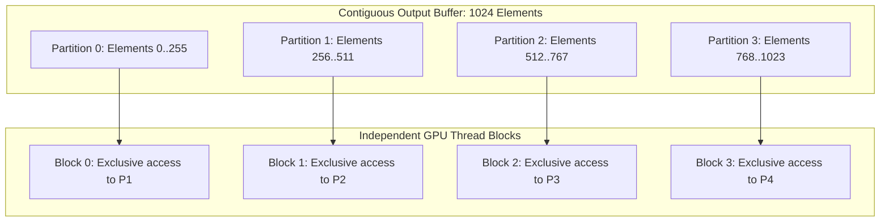

# Lesson 3: `DisjointSlice` for Data-Race-Free Parallel Writes

## Learning Goals
- Understand the parallel write dilemma in concurrent GPU computing.
- Learn the `DisjointSlice` abstraction in `cuda-rust`.
- Master non-overlapping slice partitioning.
- Eliminate GPU data races statically using Rust type safety.

---

## 1. Theory: Safe Concurrent Writes on GPU

In standard GPU programming, launching thousands of threads to write into a shared global buffer is inherently risky:
- If two threads write to the same element simultaneously, a data race occurs.
- Rust normally forbids multiple mutable references (`&mut`) to the same buffer.

### The `DisjointSlice` Solution
To permit safe parallel writes across independent GPU blocks or warps without violating Rust's Aliasing XOR Mutability rule:
- A buffer is partitioned into **disjoint** (non-overlapping) segments.
- Each disjoint segment is handed to exactly one thread block or warp.
- Because the segments share no memory addresses, parallel writes cannot race.
- The compiler statically guarantees that no two workers can write to the same index.

---

## 2. Disjoint Memory Partitioning Diagram



---

## 3. Complete Rust Code Example

```rust
use phase_04_gpu_advanced::DisjointSlice;

fn parallel_worker(mut partition: DisjointSlice<u32>, base_val: u32) {
    for i in 0..partition.len() {
        partition.write_at(i, base_val + i as u32);
    }
}

fn main() {
    let mut raw_buffer = vec![0u32; 8];

    // 1. Create top-level DisjointSlice
    let master_slice = DisjointSlice::from_slice(&mut raw_buffer);

    // 2. Partition into non-overlapping left and right halves
    let (left, right) = master_slice.split_at_mut(4);
    assert_eq!(left.len(), 4);
    assert_eq!(right.len(), 4);

    // 3. Parallel simulation: each worker mutates its partition exclusively
    parallel_worker(left, 100);
    parallel_worker(right, 200);

    // 4. Verify results
    println!("Partitioned write results: {:?}", raw_buffer);
    assert_eq!(raw_buffer, vec![100, 101, 102, 103, 200, 201, 202, 203]);
}
```

---

## 4. Code Breakdown

1. `DisjointSlice::from_slice(&mut raw_buffer)`:
   - Takes unique ownership of the mutable slice borrow.
2. `slice.split_at_mut(mid)`:
   - Verifies `mid <= len`.
   - Generates two independent `DisjointSlice` handles pointing to non-overlapping address intervals.
   - The addresses of `left` and `right` do not intersect.
3. Concurrent mutation:
   - Workers mutate their respective partitions using `write_at`.
   - Zero locks or atomic instructions required. Race freedom is guaranteed by spatial isolation.

---

## 5. Best Practices

1. **Partition by tile or chunk size**: Match slice partitions to GPU thread block sizes (e.g. 128 or 256 elements).
2. **Ensure alignment on partition boundaries**: When splitting slices, align partition offsets to 16-byte boundaries to support vectorized load/store instructions (`float4`).
3. **Avoid raw index computations**: Prefer `split_at_mut` or chunk iterators over manual raw pointer additions.

---

## 6. Common Errors

- **Out-of-bounds partition write**: Attempting to write past `partition.len()`.
  - *Fix*: Bounds-check partition offsets inside kernel launch bounds.
- **Overlapping sub-slices**: Creating two slices that share a boundary element.
  - *Fix*: Use `split_at_mut` which splits strictly between elements `mid-1` and `mid`.

---

## 7. Exercises

1. Implement a recursive binary partitioner that splits a `DisjointSlice` into $N$ equal chunks for $N$ simulated GPU blocks.
2. Verify that two threads writing to disjoint slices can execute concurrently across threads without synchronization locks.

---

## 8. Summary & Checklist

- [x] Concurrent GPU writes require non-overlapping address guarantees.
- [x] `DisjointSlice` partitions mutable buffers into independent slices.
- [x] Spatial isolation eliminates data races at compile time.
- [x] Rust ownership guarantees that no two workers can alias the same memory slice.
