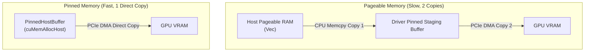

# Lesson 4: Pinned Host Memory and Unified Memory

## Learning Goals
- Understand virtual memory paging vs page-locked (pinned) host memory.
- Learn why Direct Memory Access (DMA) over PCIe requires pinned memory.
- Master `PinnedHostBuffer<T>` in `cuda-core`.
- Analyze Unified Memory (Managed Memory) page faulting and migration.

---

## 1. Theory: Paging, DMA, and Pinned Memory

Standard OS allocations (from `malloc` or `Vec`) are **pageable**:
- The operating system kernel can move physical pages between RAM and swap storage at any time.
- Physical memory addresses can change dynamically.

### Direct Memory Access (DMA)
The GPU's DMA engine requires fixed physical addresses to copy memory across the PCIe bus without CPU involvement.
- When copying from **pageable memory**, the CUDA driver must first copy the data into an internal pinned staging buffer before the GPU DMA engine can read it. This incurs a double-copy penalty.
- **Pinned Host Memory** (`cuMemAllocHost` or `PinnedHostBuffer<T>` in `cuda-core`) locks the memory pages into physical RAM. The GPU can read directly from host RAM via PCIe at full bus speed.

### Unified Memory (`cuMemAllocManaged`)
Unified Memory provides a single, unified address space accessible by both CPU and GPU:
- The CUDA driver automatically migrates memory pages between host RAM and GPU VRAM on demand via page faults.
- Simplifies programming but can incur page-fault latency spikes if access patterns are not carefully tuned.

---

## 2. Transfer Pipeline: Pageable vs Pinned Memory



---

## 3. Complete Rust Code Example

```rust
use common::{EduContext, EduStream};
use phase_04_gpu_advanced::EduPinnedHostBuffer;
use std::sync::Arc;

fn main() -> Result<(), String> {
    let context = EduContext::new(0)?;
    let stream = context.new_stream()?;

    // 1. Allocate pinned host memory
    let mut pinned_buf = EduPinnedHostBuffer::<f32>::new(context.clone(), 1024);

    // 2. Populate data on host CPU
    for i in 0..1024 {
        pinned_buf.push(i as f32 * 1.5);
    }
    println!("PinnedHostBuffer created with {} elements.", pinned_buf.len());

    // 3. In native cuda-core:
    // let dev_buf = unsafe {
    //     DeviceBuffer::from_pinned_host(&stream, &pinned_buf)?
    // };
    // PCIe DMA reads directly from pinned_buf without CPU staging!

    // 4. Clean shutdown
    stream.synchronize()?;
    println!("Pinned transfer completed successfully.");
    Ok(())
}
```

---

## 4. Code Breakdown

1. `EduPinnedHostBuffer::<f32>::new(context, 1024)`:
   - In native `cuda-core`, invokes `cuMemAllocHost`.
   - The OS kernel guarantees that these physical pages will never be swapped out or moved.
2. Direct PCIe DMA:
   - The GPU copy engine initiates DMA transfers directly from host physical addresses.
   - Achieves peak PCIe transfer speeds (e.g. 31.5 GB/s on PCIe 4.0 x16 vs ~6-10 GB/s for unpinned memory).
3. `from_pinned_host`:
   - Enqueues copy without synchronous CPU staging.

---

## 5. Best Practices

1. **Use Pinned Memory for high-frequency streaming**: Audio/video pipelines, camera ingest, and live tensor inferencing should always use pinned host staging buffers.
2. **Do not over-allocate pinned memory**: Pinned memory cannot be paged to disk. Allocating too much pinned memory reduces available physical RAM for the OS, causing system thrashing.
3. **Reuse pinned buffers via double-buffering**: Allocate two pinned buffers: while the GPU reads Buffer A, the CPU fills Buffer B. Swap buffers on each frame.

---

## 6. Common Errors

- **Dropping a pinned buffer while async DMA is in flight**:
  - The driver frees the host pages while the GPU DMA controller is still reading them, causing undefined behavior or kernel panic.
  - *Fix*: Keep pinned buffers alive until `stream.synchronize()` confirms completion.
- **Cross-context pinned memory sharing without `PORTABLE` flag**:
  - Pinned allocations are local to the context that created them unless created with `CU_MEMHOSTALLOC_PORTABLE`.
  - *Fix*: Check context matching or pass portable flags.

---

## 7. Exercises

1. Measure transfer latency comparing a 100 MB `Vec<u8>` against a 100 MB pinned host buffer.
2. Implement a double-buffering pipeline that uploads frames to the GPU continuously.

---

## 8. Summary & Checklist

- [x] Pageable host memory requires an extra copy through an internal driver staging buffer.
- [x] Pinned host memory enables direct PCIe DMA transfers.
- [x] `PinnedHostBuffer<T>` manages page-locked host memory.
- [x] Pinned memory must be kept alive until the GPU transfer finishes.
