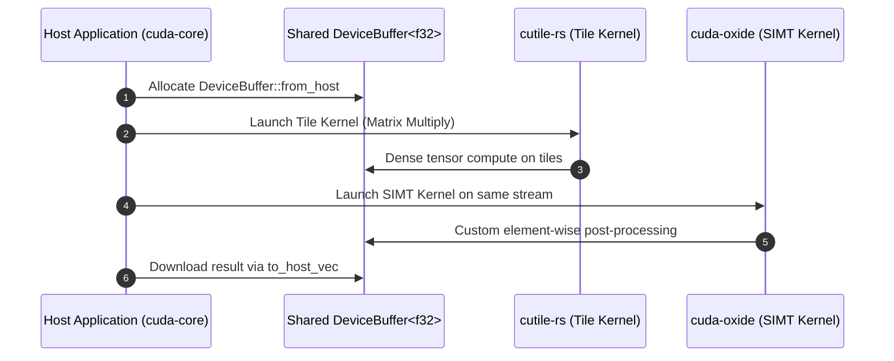

# Lesson 6: Kernel Models: SIMT (`cuda-oxide`) and Tile (`cutile-rs`)

## Learning Goals
- Compare the two kernel programming models in the NVIDIA `cuda-rust` platform.
- Understand the **SIMT model** (`cuda-oxide`): explicit threads, warps, and shared memory.
- Understand the **Tile model** (`cutile-rs`): multi-dimensional tensor operations and automatic scheduling.
- Learn how both models interoperate seamlessly over shared `DeviceBuffer` allocations.

---

## 1. Theory: The Two NVIDIA `cuda-rust` Kernel Models

The NVIDIA `cuda-rust` platform offers two complementary kernel programming models:

### 1. `cuda-oxide` (SIMT Model)
- **Target Audience**: CUDA C++ developers, systems engineers, HPC specialists.
- **Programming Concept**: Threads, thread blocks, grids, warps, and explicit shared memory.
- **Safety**: Safe launch configurations via `PreparedLaunch`, data-race freedom for disjoint slices.
- **Compilation**: Ahead-of-time (AOT) compilation from Rust to PTX using a custom `rustc` backend (pinned toolchain 1.99.1 via `cargo oxide`).
- **Best For**: Sparse algorithms, pointer chasing, graph processing, and hand-tuned hardware instructions (TMA, warp shuffle).

### 2. `cutile-rs` (Tile Model)
- **Target Audience**: Machine learning researchers, PyTorch/NumPy engineers.
- **Programming Concept**: Tensors and multi-dimensional tiles.
- **Safety**: Data-race freedom by construction. No explicit thread indexing or barrier synchronization.
- **Compilation**: Just-In-Time (JIT) compilation at first launch from Rust to Tile IR to cubin. Runs on stable Rust (1.89+).
- **Best For**: Dense linear algebra, GEMM, convolutions, and tensor contractions.

### Model Interoperability
Both models share the common runtime crates (`cuda-core`, `cuda-bindings`, `cuda-async`).
A `cutile-rs` Tile kernel and a `cuda-oxide` SIMT kernel can execute sequentially or concurrently on the same `CudaStream` over the exact same `DeviceBuffer<T>`.

---

## 2. Kernel Model Comparison Matrix

| Feature | `cuda-oxide` (SIMT) | `cutile-rs` (Tile) |
| :--- | :--- | :--- |
| **Mental Model** | Threads, warps, blocks, shared memory | Tensor tiles, partitioning |
| **Race Safety** | Enforced via disjoint slice partitioning | Data-race free by construction |
| **Thread Indexing** | Explicit (`thread_idx()`, `block_idx()`) | Implicit via tensor partitions |
| **Compiler Pipeline** | AOT (Rust $\to$ PTX) | JIT at runtime (Rust $\to$ Tile IR $\to$ cubin) |
| **Toolchain** | Pinned stable Rust (1.99.1) | Standard stable Rust (1.89+) |
| **Ideal Workload** | Irregular, sparse, pointer chasing | Dense math, matrix multiplication |

---

## 3. Interoperability Pipeline Diagram



---

## 4. Complete Rust Code Example

```rust
use common::{EduContext, EduDeviceBuffer, EduStream};
use std::sync::Arc;

/// Simulates a cutile-rs Tile kernel operating on tensor tiles
fn launch_tile_gemm_simulation(
    stream: &EduStream,
    a: &EduDeviceBuffer<f32>,
    b: &EduDeviceBuffer<f32>,
    out: &mut EduDeviceBuffer<f32>,
) -> Result<(), String> {
    stream.synchronize()?;
    // Tile model processes data in 2D tiles without manual thread indexing
    unsafe {
        let p_a = a.as_device_ptr();
        let p_b = b.as_device_ptr();
        let p_out = out.as_device_ptr();
        for i in 0..out.len() {
            *p_out.add(i) = *p_a.add(i) * *p_b.add(i);
        }
    }
    stream.synchronize()?;
    Ok(())
}

/// Simulates a cuda-oxide SIMT kernel with explicit element indexing
fn launch_simt_activation_simulation(
    stream: &EduStream,
    data: &mut EduDeviceBuffer<f32>,
) -> Result<(), String> {
    stream.synchronize()?;
    // SIMT model maps individual threads directly to elements
    unsafe {
        let ptr = data.as_device_ptr();
        for i in 0..data.len() {
            let val = *ptr.add(i);
            // ReLU activation function
            *ptr.add(i) = if val > 0.0 { val } else { 0.0 };
        }
    }
    stream.synchronize()?;
    Ok(())
}

fn main() -> Result<(), String> {
    let context = EduContext::new(0)?;
    let stream = context.new_stream()?;

    let in_a = EduDeviceBuffer::from_host(&stream, &[2.0f32, -3.0, 4.0, -1.0])?;
    let in_b = EduDeviceBuffer::from_host(&stream, &[3.0f32, 2.0, -2.0, 5.0])?;
    let mut out = EduDeviceBuffer::<f32>::zeroed(&stream, 4)?;

    // Step 1: Run Tile Model kernel (computes multiplication)
    launch_tile_gemm_simulation(&stream, &in_a, &in_b, &mut out)?;

    // Step 2: Run SIMT Model kernel (applies activation on the same buffer)
    launch_simt_activation_simulation(&stream, &mut out)?;

    // Step 3: Retrieve pipeline results
    let final_result = out.to_host_vec(&stream)?;
    println!("Interoperable pipeline output: {:?}", final_result);

    // Expected: [2*3=6, -3*2=-6 -> 0, 4*-2=-8 -> 0, -1*5=-5 -> 0]
    assert_eq!(final_result, vec![6.0, 0.0, 0.0, 0.0]);

    Ok(())
}
```

---

## 5. Best Practices

1. **Choose `cutile-rs` for dense linear algebra**: Avoids writing boilerplate thread indexing, boundary clamping, and shared-memory tile loading loops.
2. **Choose `cuda-oxide` when low-level hardware control is needed**: Use SIMT when utilizing warp shuffles, atomic memory operations, or cooperative groups.
3. **Chain kernels across models on the same stream**: Avoids copying data between device buffers when passing intermediate results from a Tile kernel to a SIMT kernel.
4. **Use `LaunchContractSpec` for SIMT kernels**: Formally verify grid, block, and shared memory geometry before submitting to the driver.

---

## 6. Common Errors

- **Assuming Tile kernels require manual synchronization**: Tile kernels handle tile loading and synchronization automatically inside the compiler.
- **Mismatched toolchains**: Trying to compile `cuda-oxide` with standard stable `rustc` instead of using the pinned toolchain managed by `cargo oxide`.
  - *Fix*: Install `cargo-oxide` and use `cargo oxide build`.

---

## 7. Exercises

1. Compare writing a $16 \times 16$ matrix transpose in `cuda-oxide` (with shared memory padding) versus describing it as a tensor view in `cutile-rs`.
2. Construct a pipeline that passes a tensor output from a convolution kernel directly into a custom reduction kernel on the same stream.

---

## 8. Summary & Checklist

- [x] `cuda-oxide` provides fine-grained SIMT control with explicit threads.
- [x] `cutile-rs` provides high-level Tile abstractions for tensor math.
- [x] Both models share the `cuda-core` runtime and `DeviceBuffer` structures.
- [x] Kernels from both models interoperate seamlessly on the same stream.
