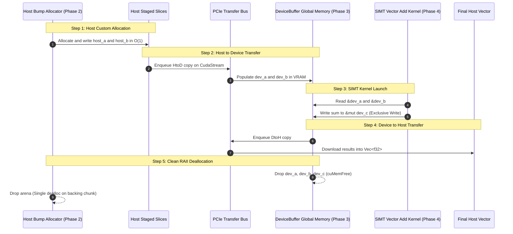

# Lesson 1: Complete End-to-End CPU Arena to GPU Kernel Pipeline

## Learning Goals
- Integrate CPU custom memory allocators with GPU runtime memory buffers.
- Allocate and stage host data using a custom **Bump/Arena Allocator**.
- Transfer data across the PCIe bus into `DeviceBuffer<T>` instances.
- Execute a vector addition kernel in the SIMT model.
- Copy computed results back to the host and release all resources with RAII.

---

## 1. Theory: The Heterogeneous Memory Pipeline

In modern high-performance heterogeneous applications, CPU memory allocation and GPU kernel execution must cooperate smoothly:
1. **CPU Staging with Custom Arenas**: Standard OS `malloc` introduces heap overhead. High-throughput pipelines stage input data in a custom **Arena/Bump Allocator** with zero per-allocation metadata.
2. **PCIe Memory Ingest**: The CPU data is transferred into GPU global memory using `DeviceBuffer::from_host` or pinned host buffers.
3. **GPU Kernel Execution**: The kernel executes on an independent `CudaStream`. Rust ownership guarantees:
   - Inputs (`&DeviceBuffer<T>`) are borrowed immutably.
   - Outputs (`&mut DeviceBuffer<T>`) are borrowed exclusively.
4. **Result Ingest & RAII Teardown**: Results download to the host CPU via `to_host_vec()`. When handles exit scope, RAII drops release GPU memory (`cuMemFree`) and the arena backing chunk with zero memory leaks.

---

## 2. Complete End-to-End Memory Flow Diagram



---

## 3. Complete Rust Implementation

The runnable implementation lives in `phase-05-full-pipeline/src/main.rs`. Here is the complete code:

```rust
use common::{EduContext, EduDeviceBuffer, EduStream};
use phase_02_cpu_low_level::BumpAllocator;
use std::alloc::Layout;
use std::sync::Arc;

pub fn launch_vector_add_simt(
    stream: &EduStream,
    a: &EduDeviceBuffer<f32>,
    b: &EduDeviceBuffer<f32>,
    c: &mut EduDeviceBuffer<f32>,
) -> Result<(), String> {
    assert_eq!(a.len(), b.len());
    assert_eq!(a.len(), c.len());

    stream.synchronize()?;

    // SAFETY: Slices are valid and non-overlapping. Output has exclusive &mut access.
    unsafe {
        let ptr_a = a.as_device_ptr();
        let ptr_b = b.as_device_ptr();
        let ptr_c = c.as_device_ptr();

        for i in 0..c.len() {
            *ptr_c.add(i) = *ptr_a.add(i) + *ptr_b.add(i);
        }
    }

    stream.synchronize()?;
    Ok(())
}

fn main() -> Result<(), String> {
    let n = 8;
    println!("=== Phase 5: Executing Complete End-to-End Pipeline ===");

    // 1. Allocate host input memory using custom Bump Allocator
    let byte_size = n * std::mem::size_of::<f32>();
    let arena = BumpAllocator::new(byte_size * 2 + 1024);
    let layout = Layout::array::<f32>(n).map_err(|e| e.to_string())?;

    // SAFETY: Memory allocated inside arena and initialized with valid f32 data.
    let host_a = unsafe {
        let p = arena.alloc(layout).expect("Arena alloc A failed") as *mut f32;
        for i in 0..n {
            std::ptr::write(p.add(i), i as f32 * 1.0);
        }
        std::slice::from_raw_parts(p, n)
    };

    // SAFETY: Memory allocated inside arena and initialized with valid f32 data.
    let host_b = unsafe {
        let p = arena.alloc(layout).expect("Arena alloc B failed") as *mut f32;
        for i in 0..n {
            std::ptr::write(p.add(i), i as f32 * 2.0);
        }
        std::slice::from_raw_parts(p, n)
    };

    // 2. Initialize CUDA Context and Stream
    let context: Arc<EduContext> = EduContext::new(0)?;
    let stream: Arc<EduStream> = context.new_stream()?;

    // 3. Upload host slices to GPU DeviceBuffers
    let dev_a = EduDeviceBuffer::from_host(&stream, host_a)?;
    let dev_b = EduDeviceBuffer::from_host(&stream, host_b)?;
    let mut dev_c = EduDeviceBuffer::<f32>::zeroed(&stream, n)?;

    // 4. Launch SIMT Vector Add Kernel
    launch_vector_add_simt(&stream, &dev_a, &dev_b, &mut dev_c)?;

    // 5. Download results to host vector
    let results = dev_c.to_host_vec(&stream)?;
    println!("Output results: {:?}", results);

    // 6. Verify correct execution
    for i in 0..n {
        let expected = (i as f32 * 1.0) + (i as f32 * 2.0);
        assert_eq!(results[i], expected);
    }
    println!("Verification: ALL VALUES COMPUTED CORRECTLY!");

    // All host and GPU buffers cleanly reclaimed via RAII on scope exit
    Ok(())
}
```

---

## 4. Code Breakdown

1. Host Staging:
   - `arena.alloc(layout)` avoids calling the system allocator for each individual array. Both input vectors are allocated contiguously inside the arena.
2. PCIe Transfer:
   - `EduDeviceBuffer::from_host` copies data across the bus to GPU global memory.
3. SIMT Kernel Execution:
   - The kernel takes `&dev_a`, `&dev_b`, and `&mut dev_c`. The Rust compiler enforces that `dev_c` cannot alias `dev_a` or `dev_b`, preventing GPU memory corruption.
4. RAII Teardown:
   - When the function returns, `dev_a`, `dev_b`, and `dev_c` drop and trigger `cuMemFree`.
   - The `arena` drops and deallocates its backing buffer in a single call. No pointers leak.

---

## 5. Best Practices

1. **Pre-allocate host buffers with arenas for streaming pipelines**: Eliminates OS allocation jitter when serving live GPU inference.
2. **Batch allocations and kernel launches on the same stream**: Maximizes GPU queue occupancy.
3. **Always document safety invariants for raw device pointers**: Explicitly state that pointer offsets remain within allocation bounds.
4. **Rely on RAII for cleanup**: Never leave manual deallocation calls to the caller.

---

## 6. Common Errors

- **Attempting to access arena-allocated host slices after arena drops**:
  - The slice references memory that has been deallocated.
  - *Fix*: Keep the arena in scope as long as the host slices are in use.
- **Dropping GPU buffers before stream synchronization**:
  - Leads to device-side use-after-free.
  - *Fix*: Synchronize streams before teardown or use asynchronous completion leases.

---

## 7. Exercises

1. Extend the pipeline to compute vector scaling ($A \cdot x + B$) in a single kernel launch.
2. Replace the synchronous `from_host` copy with pinned host memory and asynchronous transfers to measure the performance improvement.

---

## 8. Summary & Checklist

- [x] Host arenas stage data with zero per-allocation heap overhead.
- [x] PCIe transfers upload data to GPU `DeviceBuffer` instances.
- [x] SIMT kernels execute parallel workloads with compile-time borrow safety.
- [x] Results download cleanly back to the host CPU.
- [x] All host and device memory is reclaimed automatically by RAII.
